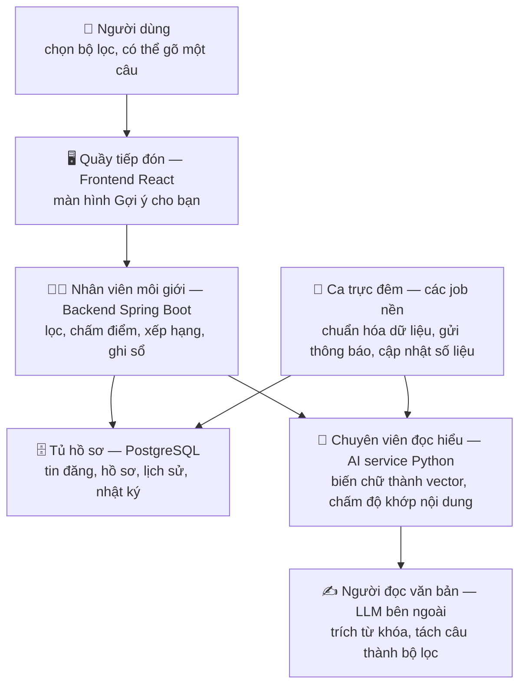
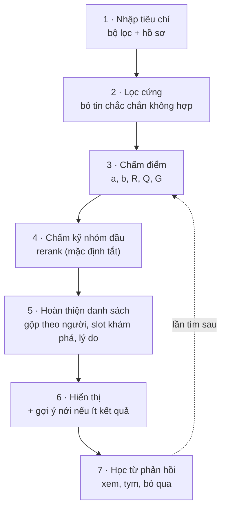

# 0. Đọc trước — Đề xuất gia sư ↔ học viên giải thích bằng lời thường

> File này giải thích **toàn bộ thiết kế bằng ngôn ngữ dễ hiểu**, không cần biết trước về AI hay hệ gợi ý. Đọc hết
> file này (khoảng 15 phút) là đủ để nắm tính năng hoạt động thế nào và vì sao thiết kế như vậy. Các file 01–12 là
> bản kỹ thuật chi tiết để code theo; mỗi file và mỗi mục trong đó đều có khung 💡 giải thích ngắn. Cuối file này có
> bảng "muốn biết gì thì đọc file nào".

---

## 1. Tính năng này làm gì?

PTutor đã có trang "Tất cả tin đăng": lọc theo môn, lớp… rồi xếp theo **thời gian đăng**. Tin mới nhất lên đầu, dù
có hợp với người xem hay không. Tính năng đề xuất thêm một chế độ **"Gợi ý cho bạn"**: cũng là danh sách tin đăng,
nhưng xếp theo **mức hợp nhau thật sự**.

| Ai tìm | Nhập gì | Nhận được gì |
|---|---|---|
| **Học viên** (học sinh / phụ huynh) | Môn, lớp, hình thức học, khu vực, học phí, lịch rảnh, phong cách mong muốn… | Danh sách **tin dạy** của gia sư (tin đã trả phí, đã được duyệt), xếp từ hợp nhất xuống |
| **Gia sư** | Môn, các lớp dạy được, khu vực dạy, mức giá mong muốn, lịch rảnh, đối tượng muốn dạy | Danh sách **tin học** của học viên, xếp từ hợp nhất xuống |

Ví dụ: Minh học lớp 9, yếu hình học, muốn ôn thi vào 10, rảnh tối thứ Ba và thứ Năm, ngân sách ≤ 200.000 đ/buổi.
Ở chế độ "Tất cả", Minh thấy 46 tin dạy Toán lớp 9 xếp theo ngày đăng. Ở chế độ "Gợi ý cho bạn", tin của một gia sư
**mạnh hình học, rảnh đúng tối thứ Ba – thứ Năm, giá 180.000 đ, và hay nhận học sinh như Minh** sẽ đứng đầu, kèm
lý do: *"Mạnh về Hình học phẳng, đúng phần bạn cần cải thiện · Trùng lịch rảnh: Thứ Ba, Thứ Năm 19:00–21:00 ·
Học phí 180.000đ — nằm trong ngân sách"*.

Vài điểm quan trọng:

- **Người tìm không cần có tin đăng.** Minh chưa đăng tin tìm gia sư vẫn tìm được. Gia sư chưa có tin dạy vẫn tìm
  được học viên (nhưng hồ sơ phải được duyệt).
- **Bộ lọc là cách nhập chính** (danh sách chọn, ô số, lưới lịch, các "chip" bấm chọn). Người dùng **có thể** gõ
  một câu như *"Gia sư Toán lớp 9 kiên nhẫn, tối thứ 3 và 5, dưới 200k"*: hệ thống tự điền câu đó vào các ô bộ lọc để
  người dùng xem lại rồi mới bấm tìm.
- **Ít kết quả** thì hệ thống gợi ý cách nới tiêu chí: *"Mở rộng ra toàn Hà Nội: thêm 7 gia sư phù hợp"*.
- **Lưu tìm kiếm**: bấm lưu, khi có tin mới rất hợp thì hệ thống **tự gửi thông báo**.
- **Càng dùng càng hiểu người dùng**: những gì người dùng mở xem, thả tim, gửi đơn… được dùng để đẩy các tin giống
  vậy lên cao hơn ở các lần sau.

Đây **không phải chatbot**. AI chỉ được dùng ở vài chỗ hẹp (đọc văn bản tự do, so nghĩa câu chữ), còn việc lọc và
chấm điểm là **công thức rõ ràng** trong code Java, giải thích được từng con số.

---

## 2. Hệ thống gồm những bộ phận nào?

Hình dung như **một văn phòng môi giới gia sư**:

| Bộ phận | Ví von | Việc cụ thể |
|---|---|---|
| **Frontend** (React) | Quầy tiếp đón | Màn hình bộ lọc, danh sách kết quả, nút thả tim / "Không quan tâm", gợi ý nới tiêu chí |
| **Backend** (Spring Boot, Java) | Nhân viên môi giới | **Mọi quyết định** nằm ở đây: lọc, tính điểm, xếp hạng, chọn lý do, ghi nhật ký |
| **Cơ sở dữ liệu** (PostgreSQL + pgvector) | Tủ hồ sơ | Tin đăng, hồ sơ, đơn đã gửi, nhật ký mỗi lần tìm. *pgvector* là phần mở rộng giúp database lưu và so sánh vector |
| **AI service** (Python, chạy ngay trên máy chủ) | Chuyên viên đọc hiểu | Ba việc: biến câu chữ thành **vector** (dãy số đại diện ý nghĩa), **chấm lại độ khớp** của một cặp văn bản (rerank, mặc định tắt từ 26/10/2026), và chuyển lời cho LLM. Không quyết định thứ hạng |
| **LLM** (OpenAI, gọi qua mạng) | Người đọc văn bản thuê ngoài | Đọc văn bản tự do và trả lời bằng **mã có sẵn trong danh sách** (ví dụ `hinh_hoc_phang`). Không viết nội dung cho người dùng |
| **Job nền** | Ca trực đêm | Chạy định kỳ: chuẩn hóa dữ liệu mới, tính vector, gửi thông báo ghép đôi, đếm lượt hiển thị, cập nhật hồ sơ sở thích |

Hai nguyên tắc an toàn:

- **AI service chết thì tính năng vẫn chạy**, chỉ kém chính xác hơn một chút. Mọi lời gọi tới nó đều có giới hạn thời
  gian và phương án dự phòng.
- **Không gửi thông tin cá nhân ra ngoài**: tên, số điện thoại, email, địa chỉ chi tiết bị lọc trước khi gửi cho LLM.
  Vector và rerank chạy ngay trên máy chủ của mình.

---

## 3. Đi theo một lượt tìm kiếm từ đầu đến cuối

Minh (lớp 9) tìm gia sư **Toán lớp 9**, ưu tiên **học online buổi tối**, nếu học trực tiếp thì ở **Cầu Giấy**.
Các con số dưới đây là **minh họa**; con số của gia sư X, Y lấy đúng từ ví dụ tính tay ở
[06](./06-thuat-toan-xep-hang.md), mục 6.14.

**Bước 1 — Nhập tiêu chí.** Minh chọn: Toán, lớp 9, hình thức "Cả hai", khu vực Cầu Giấy, học phí ≤ 200.000 đ, lịch
tối thứ Ba và thứ Năm 19–21h, phong cách "Kiên nhẫn" và "Giải thích kỹ". Ô nào Minh để trống thì hệ thống **lấy từ
hồ sơ** của Minh: hồ sơ ghi "yếu hình học, hay sai bài chứng minh, muốn thi vào 10, học lực trung bình". Tất cả gộp
lại thành một **nhu cầu** (trong code gọi là `QueryContext`). Hệ thống cũng ghép nhu cầu thành một đoạn văn ngắn
("Môn Toán, Lớp 9. Mục tiêu: Thi vào 10. Cần cải thiện: Hình học phẳng…") và biến đoạn văn đó thành vector để lát nữa
so nghĩa.

**Bước 2 — Lọc cứng.** Bỏ ngay những tin **chắc chắn không hợp**: không phải tin dạy Toán, không dạy lớp 9, gia sư
chưa được duyệt hoặc bị khóa, tin học trực tiếp mà không dạy ở Cầu Giấy, học phí vượt quá 1,5 lần ngân sách (tức
trên 300.000 đ), Minh đang có hợp đồng với gia sư đó, hoặc Minh đã gửi đơn vào tin đó rồi.
*Minh họa: 180 tin dạy đang mở → còn 46 tin.*

**Bước 3 — Chấm điểm.** Mỗi tin trong 46 tin được tính một **điểm cuối** từ 0 đến 1, ghép từ các phần sau (giải thích
kỹ ở mục 4):

- **a — Minh có thích tin này không?** So nội dung, thế mạnh, giá, phong cách, lịch, khu vực, trình độ.
- **b — Gia sư có khả năng nhận Minh không?** Dựa vào việc gia sư hay nhận học sinh kiểu nào, Minh có hợp tiêu chí
  của gia sư không, và tin đó **đang có bao nhiêu người chờ**.
- **R** gộp a và b sao cho **phải hợp cả hai phía**.
- **Q** (uy tín gia sư) và **G** (hai "phanh" phạt nhẹ) điều chỉnh R thành điểm cuối.

| | Gia sư X | Gia sư Y |
|---|---|---|
| Hợp với Minh (a) | 0,871 — rất hợp: mạnh hình học, trùng lịch, giá 180k | 0,75 — khá hợp |
| Khả năng nhận Minh (b) | 0,341 — chỉ còn 1 chỗ mà đã có 3 người chờ | 0,80 — tin còn trống, hay nhận học sinh như Minh |
| Gộp hai phía (R) | 0,627 | 0,767 |
| Uy tín (điểm chất lượng 82 / 60) | × 0,946 | × 0,88 |
| **Điểm cuối** | **0,593** | **0,675** → **Y đứng trên X** |

X hợp hơn về nội dung, nhưng nếu đưa X lên đầu thì Minh rất có thể bị từ chối. Hệ thống ưu tiên Y — người **vừa
hợp vừa có khả năng nhận**.

**Bước 4 — Chấm kỹ nhóm đầu (rerank, hiện tắt).** Bước 3 so nghĩa bằng vector — nhanh nhưng thô. Thiết kế có thêm
một mô hình AI chính xác hơn đọc **từng cặp** (nhu cầu của Minh, nội dung tin) cho **10 tin điểm cao nhất** và chấm
lại độ khớp; điểm mới thay cho phần lớn điểm so nghĩa cũ, rồi 10 tin này được sắp lại. Đánh giá trên mô phỏng cho
thấy bước này không làm thứ tự tốt hơn mà làm chậm lần tìm (khoảng 0,18 giây mỗi cặp), nên từ 26/10/2026 mặc định
**tắt**. Code vẫn giữ: khi bật, mô hình chấm ở nền (lần tìm không phải chờ) và **nhớ kết quả** cho lần sau.

**Bước 5 — Hoàn thiện danh sách.**
- **Gộp theo người**: gia sư có 2 tin cùng khớp thì chỉ giữ tin điểm cao hơn, để danh sách là 20 *người* khác nhau
  (bước này thực ra chạy ngay trước rerank, để không tốn công chấm kỹ tin sẽ bị bỏ).
- **Slot khám phá**: vị trí **5** và **12** được dành cho tin "khá tốt nhưng ít được ai thấy" (ví dụ gia sư mới).
- **Lý do khớp**: mỗi tin có tối đa 3 câu lý do và 1 câu lưu ý, sinh từ chính các con số đã tính (không do AI viết).

**Bước 6 — Hiển thị.** Minh thấy 20 kết quả đầu, mỗi kết quả kèm lý do. Nếu chỉ có ít tin điểm cao (dưới 5 tin đạt
0,5 điểm), hệ thống thử nới từng tiêu chí và gợi ý: *"Nếu ngân sách 230.000 đ: thêm 4 gia sư phù hợp"*, bấm một lần
là áp dụng. Mỗi lần tìm được ghi vào **nhật ký** kèm đủ các con số, nên lật trang không bị xáo thứ tự và sau này giải
thích được "vì sao người này đứng đầu".

**Bước 7 — Học từ phản hồi.** Minh mở xem gia sư Y và gia sư Z (cả hai đều thiên về luyện đề), bấm "Không quan tâm"
một tin khác.
- **Ngay trong lần tìm này**: phần danh sách Minh chưa xem được sắp lại, đẩy các tin giống Y, Z lên.
- **Các lần tìm sau**: hệ thống ghi nhớ Minh hay quan tâm gia sư kiểu luyện đề; sau khoảng 10 lần tương tác, "sở
  thích của Minh" chiếm tới 15% điểm a.
- **Về lâu dài (đang ở bước thiết kế)**: phản hồi của mọi người dùng được dùng để chỉnh lại **trọng số chung** (mức
  quan trọng của giá so với lịch, so với nội dung…).

---

## 4. Các ý chính, giải thích bằng trực giác

### 4.1. Điểm phù hợp a — "Mình có thích tin này không?"

a là **điểm trung bình có trọng số** của 7 tiêu chí nhỏ, mỗi tiêu chí từ 0 (không hợp) tới 1 (rất hợp):

| Tiêu chí | Hỏi điều gì | Trọng số |
|---|---|---|
| Nội dung (`f_sem`) | Nội dung tin có "nói cùng chuyện" với nhu cầu không (so nghĩa câu chữ) | 30% |
| Thế mạnh (`f_need`) | Gia sư có mạnh đúng phần mình yếu không | 20% |
| Giá (`f_price`) | Học phí có nằm trong ngân sách không | 20% |
| Phong cách (`f_style`) | Có đúng phong cách mình muốn (kiên nhẫn, nghiêm khắc…) không | 10% |
| Lịch (`f_sched`) | Lịch rảnh hai bên trùng bao nhiêu | 10% |
| Khu vực (`f_area`) | Gần quận mình chọn không | 5% |
| Trình độ (`f_segment`) | Mình có thuộc đối tượng gia sư muốn dạy không | 5% |

Ví dụ: giá tin là 220.000 đ, ngân sách 200.000 đ → vượt 10% → `f_price` = 0,8 (vượt càng nhiều càng thấp, vượt 50%
thì về 0). **Thiếu thông tin** (ví dụ Minh không chọn lịch) thì tiêu chí đó tính **0,5 — trung tính**, không thưởng
cũng không phạt; nếu thiếu quá nhiều, kết quả được gắn nhãn "độ tin cậy thấp" và giao diện gợi ý chọn thêm tiêu chí.

### 4.2. Khả năng đồng ý b — "Phía kia có nhận mình không?"

Gợi ý gia sư khác gợi ý phim: phim không từ chối người xem, còn **gia sư có thể từ chối học sinh**. b ước lượng khả
năng gia sư nhận, từ ba nguồn:

- **Lịch sử của gia sư** (`b_hist`): gia sư từng nhận / từ chối những đơn **giống Minh** (cùng lớp, giá gần, cùng hình
  thức) ra sao. Gia sư mới chưa có lịch sử thì lấy **tỉ lệ nhận chung của cả nền tảng** (mặc định 60%). Ít dữ liệu thì
  ước lượng được "kéo" về mức chung để khỏi kết luận vội — gọi là **làm trơn Bayes**: 1 lần nhận / 1 đơn không có nghĩa
  là 100%.
- **Mức hợp tiêu chí công khai của gia sư** (`b_fit`): trình độ, lịch, giá của Minh có đúng thứ gia sư ghi trong tin
  không.
- **Chống dồn đơn** (`b_cap`, mục 4.5).

Nếu gia sư **đã chủ động mời** học sinh này thì b = 1.

### 4.3. Gộp hai phía R — "Phải hợp cả hai phía"

Có a và b rồi, gộp thế nào? Nếu lấy trung bình cộng thì một bên rất thấp vẫn được bên kia bù: a = 0,9, b = 0,05 cho
0,475 — nghe "trung bình", trong khi thực tế Minh gần như chắc bị từ chối. Hệ thống dùng **trung bình nhân có trọng
số** `R = a^0,65 · b^0,35`: một bên càng gần 0 thì R càng tụt nhanh (cùng ví dụ R ≈ 0,33; b = 0 thì R = 0). Muốn R
cao thì **cả hai** phải cao. Ý tưởng tính riêng hai chiều rồi gộp lấy từ mô hình **RECON** (Pizzato và cộng sự,
2010), một công trình kinh điển về **gợi ý hai chiều** (reciprocal recommendation). RECON gộp bằng trung bình điều hoà
`2ab / (a + b)`; nhóm đổi sang trung bình nhân và cho a nặng hơn (0,65) vì b chỉ là ước lượng thô (nhiều gia sư còn ít
lịch sử nhận đơn). Trên mô phỏng thị trường đông, cách này cho danh sách hợp hơn mà số lần bị từ chối không tăng
([13](./13-tinh-chinh-sau-danh-gia.md), mục 13.5).

### 4.4. Hệ số chất lượng Q và hệ số chặn mềm G

- **Q** = điểm uy tín của gia sư (0–100, chia 100), tính từ đánh giá sao, số hợp đồng đã hoàn thành, tỉ lệ nhận đơn,
  tốc độ phản hồi, kinh nghiệm, xác minh hồ sơ, và trừ điểm nếu từng bị khóa tài khoản. Điểm cuối nhân với
  `(0,7 + 0,3·Q)`, tức Q chỉ **dịch điểm trong khoảng ±15%** quanh mức giữa: uy tín được cộng thêm, nhưng gia sư mới
  không bị đè bẹp. Từ 20/10/2026 điểm này trừ thêm khi **nhân viên đã kết luận gia sư có lỗi** trong khiếu nại
  (khiếu nại chưa kết luận hay vô căn cứ không bị tính).
- **G** là hai "phanh" phạt nhẹ thay vì loại hẳn: lịch hai bên **không trùng chút nào** → nhân 0,4; gia sư **đã từng từ
  chối** chính học sinh này trong 90 ngày → nhân 0,5. Tin vẫn hiện, nhưng xuống thấp.

Vì sao **nhân** chứ không **cộng**? Nếu cộng, một điểm rất cao ở chỗ này có thể "bù" cho một điểm rất tệ ở chỗ khác.
Nhân thì một yếu tố tệ kéo cả điểm xuống — giống "một con sâu làm rầu nồi canh".

### 4.5. Chống dồn đơn

Nếu ai cũng thấy cùng một gia sư "xịn" ở đầu danh sách thì tất cả cùng gửi đơn cho người đó: gia sư không nhận hết,
phần lớn học sinh bị từ chối, còn các gia sư khác không ai hỏi tới. Hệ thống tính:

`b_cap = r / (r + 0,5·(n − r + 1))` khi số người chờ n đã bằng hoặc vượt số chỗ còn trống r; còn chỗ cho mọi người
đang chờ (n < r) thì `b_cap = 1`.

Còn 1 chỗ, chưa ai chờ → 1 (không ảnh hưởng). Còn 1 chỗ, 2 người chờ → 0,5. Còn 1 chỗ, 6 người chờ → 0,25. Còn 3 chỗ,
2 người chờ → 1 (chưa dồn, không phạt). Tin càng
"đông" thì càng xuống thấp, nhường chỗ cho tin còn trống. Ý tưởng lấy từ Su, Bayoumi, Joachims (2022) về xếp hạng
trong **thị trường ghép đôi**.

### 4.6. Rerank — chấm kỹ nhóm đầu

Có hai kiểu mô hình AI so nghĩa:

- **Bi-encoder** (mô hình `bge-m3`): biến **từng** văn bản thành vector riêng, rồi so khoảng cách. Nhanh, tính sẵn được
  cho mọi tin đăng — dùng để chấm cả danh sách.
- **Cross-encoder** (mô hình `bge-reranker-v2-m3`): đọc **cả hai văn bản cùng lúc** rồi cho điểm. Chính xác hơn nhiều
  nhưng chậm — chỉ dùng cho 10 tin đầu. **Hiện mặc định tắt** (từ 26/10/2026): trên mô phỏng, chấm đủ mọi cặp vẫn
  không làm thứ tự tốt hơn mà làm chậm lần tìm; code giữ lại, khi bật thì chấm ở nền.

Giống tuyển dụng: vòng 1 lọc hồ sơ nhanh, vòng 2 phỏng vấn kỹ vài người. Kết quả chấm được lưu lại (cache) để lần sau
không phải chấm lại; ban đêm hệ thống còn chấm sẵn cho các nhu cầu đã biết trước.

### 4.7. Slot khám phá — cho người mới cơ hội

Nếu chỉ xếp theo điểm, tin nào từng được bấm nhiều sẽ mãi đứng đầu, tin mới không bao giờ được thấy để có cơ hội được
bấm. Vị trí **5 và 12** được dành cho tin "đủ tốt" (điểm ≥ 80% điểm của hạng 20) nhưng **ít được hiển thị**. Chọn tin
nào bằng **Thompson Sampling**: mỗi tin có một "khoảng ước đoán" về tỉ lệ được bấm; tin mới chưa có dữ liệu thì
khoảng rất rộng nên đôi khi rút ra con số cao và được chọn; tin đã hiện nhiều mà ít ai bấm thì khoảng hẹp và thấp, dần
hết được chọn. Bốn vị trí đầu không bị đụng tới. Tin ở slot này có lý do "Gia sư mới trên nền tảng".

### 4.8. Cá nhân hóa theo hành vi

Hai tầng, đều chỉ dùng **hành vi của chính người đó**:

- **Trong một lần tìm** (B5, kỹ thuật **Rocchio**): sau khi Minh mở một vài tin, "hướng tìm" được dịch về phía các tin
  Minh mở và ra xa các tin Minh bỏ qua; phần chưa xem được sắp lại. Phần đã xem giữ nguyên để không gây rối.
- **Qua nhiều lần tìm** (H1, **hồ sơ sở thích**): mỗi hành vi có điểm (xem +1, tym +2, gửi đơn +3, được nhận +4, bỏ qua
  −2), **mờ dần theo thời gian** (sau 30 ngày còn một nửa). Từ đó hệ thống biết Minh hay thích kiểu gia sư nào. Người
  mới chưa có lịch sử thì phần này **chiếm 0%**, tăng dần tới 15% khi có khoảng 10 tín hiệu. Người dùng có nút **"Xóa
  lịch sử gợi ý"**.

### 4.9. Học trọng số (L1 — bandit / Thompson Sampling) — đang là thiết kế

Các trọng số 30% / 20% / 20%… ở mục 4.1 là **nhóm tự đặt** theo kinh nghiệm. Có thể chưa đúng: biết đâu học sinh
thật coi giá quan trọng hơn nội dung. L1 cho hệ thống **tự chỉnh dần** các trọng số này từ phản hồi:

- Trọng số nhóm đặt trở thành **điểm xuất phát** (*prior*). Chưa có dữ liệu thì hệ thống chạy **y hệt** hiện tại.
- Mỗi đêm, hệ thống xem: với bộ trọng số đã dùng, người dùng có mở / tym / gửi đơn vào các tin được đưa lên không, rồi
  dịch trọng số về phía làm người dùng phản ứng tốt hơn.
- Phía a dùng **contextual bandit** với **Linear Thompson Sampling**: thay vì luôn dùng bộ trọng số "đang tốt nhất",
  hệ thống thỉnh thoảng thử bộ hơi khác (lúc còn ít dữ liệu thì thử nhiều, chắc dần thì thử ít). Không thử thì không
  bao giờ biết bộ khác có tốt hơn không. "Bandit" lấy tên từ máy đánh bạc nhiều cần gạt: bài toán chọn cần nào vừa để
  kiếm điểm, vừa để tìm hiểu cần nào tốt.
- Phía b học từ quyết định **nhận / từ chối** thật trong bảng đơn, không cần thử.
- **Lưới an toàn**: trọng số mới chỉ được nằm trong khoảng 0,5–2 lần giá trị nhóm đặt, mỗi đêm đổi tối đa 0,05; bản mới
  kém hơn thì không được dùng; mặc định chỉ **chạy ngầm** (tính và ghi lại, chưa phục vụ người dùng).

Theo code trên nhánh ngày 18/10/2026, L1 **chưa được lập trình**; thiết kế chi tiết ở [12](./12-hoc-trong-so.md).

### 4.10. Dữ liệu mô phỏng để đánh giá

Chưa có người dùng thật thì làm sao biết thuật toán tốt? Nhóm **tự tạo một "thế giới ảo"**:

1. Code sinh ra học sinh và gia sư ảo với **thuộc tính ẩn**: nhu cầu thật, ngân sách, lịch, gia sư thật sự thích nhận
   học sinh nào…
2. LLM viết hồ sơ, tin đăng dạng chữ từ các thuộc tính đó (có cả hồ sơ sơ sài, viết tắt, sai chính tả).
3. Hệ thống đề xuất **chỉ đọc chữ**, như với người thật. Vì nhóm biết thuộc tính ẩn nên biết **đáp án đúng**, chấm được
   điểm khách quan.

Giống thầy giáo tự soạn đề có đáp án để kiểm tra một phương pháp giải. Các phiên bản thuật toán được so với nhau bằng
cùng bộ đề (chỉ số như NDCG@10 — "các tin phù hợp có nằm ở đầu không"). Dữ liệu ảo vẫn có hạn chế: hành vi người thật
có thể khác, điều này phải nêu rõ trong báo cáo.

### 4.11. Hai việc AI làm ở hậu trường

- **A1 — chuẩn hóa văn bản tự do** (chạy nền): hồ sơ ghi *"yếu hình, hay sai bài chứng minh, muốn thi vào 10"* → LLM
  chọn mã `hinh_hoc_phang`, `chung_minh`, `thi_vao_10` trong một **bộ từ vựng có sẵn** (admin quản lý). Lịch dạng chữ
  *"tối thứ 2, 4, 6"* → các khung giờ cụ thể. Code kiểm tra lại mọi kết quả; LLM không được tự tạo mã mới, không ghi
  đè dữ liệu người dùng tự nhập.
- **A2 — tách câu tự nhiên** thành giá trị bộ lọc (mục 1). Người dùng luôn xem lại trước khi bấm tìm.

---

## 5. Những gì cố ý không làm

| Không làm | Vì sao |
|---|---|
| **Collaborative filtering** ("người giống bạn cũng thích…") | Cần rất nhiều tương tác giữa nhiều người; nền tảng mới thì dữ liệu quá thưa |
| **Learning-to-rank / mạng nơ-ron** (mô hình xếp hạng học hoàn toàn từ dữ liệu) | Cần hàng nghìn phiên có nhãn, khó giải thích. Để làm hướng phát triển, huấn luyện trên chính nhật ký của L1 |
| **Deep reinforcement learning** | Bài toán chỉ có một bước (hiển thị → phản hồi), dữ liệu ít; contextual bandit là dạng học tăng cường vừa đủ |
| **Tối ưu toàn cục / Gale–Shapley** (ghép cặp cho cả thị trường cùng lúc) | Nặng; ở quy mô đồ án, chống dồn đơn đơn giản là đủ |
| **Xếp theo "ghép đôi thành công lâu dài"** | Cần nhiều hợp đồng đã kết thúc |
| **Chatbot hỏi đáp** | Bộ lọc nhanh và rõ hơn; LLM chỉ được gọi một lượt cho mỗi tác vụ trích xuất |
| **Dùng tọa độ địa lý** | Nhóm đã chốt chỉ so quận / tỉnh |
| **Gia sư đánh giá học sinh** | Nhóm đã chốt không làm (nên chiều gia sư tìm học viên không có Q) |
| **Hiện lý do liên quan khiếu nại cho học sinh** | Thông tin xử lý khiếu nại là nội bộ |

---

## 6. Giải nghĩa thuật ngữ

| Thuật ngữ | Nghĩa đơn giản |
|---|---|
| **Người tìm / ứng viên** | Bên đang tìm / các tin đăng `OPEN` (đang mở) của phía bên kia |
| **Tin học (SR) / tin dạy (TR)** | `studying_requests` — tin tìm gia sư của học sinh / `teaching_requests` — tin tìm học viên của gia sư |
| **S→T / T→S** | Học sinh tìm gia sư / gia sư tìm học viên |
| **`QueryContext`** (nhu cầu) | Toàn bộ tiêu chí sau khi gộp bộ lọc, câu gõ, hồ sơ |
| **Lọc cứng** | Loại hẳn tin không đạt điều kiện bắt buộc |
| **Đặc trưng (feature), `f_…`** | Một tiêu chí nhỏ được chấm 0–1, ví dụ `f_price` là điểm giá |
| **Trọng số (weight)** | Mức quan trọng của từng tiêu chí khi cộng lại |
| **a, b, R, Q, G** | Độ phù hợp với người tìm; khả năng phía kia đồng ý; điểm gộp hai chiều; uy tín gia sư; hệ số phạt nhẹ |
| **Reciprocal (hai chiều)** | Gợi ý người cho người, phải hợp cả hai phía |
| **Trung bình nhân có trọng số** | Cách gộp a và b: `a^0,65 · b^0,35`; một bên bằng 0 thì kết quả bằng 0 (RECON dùng trung bình điều hoà `2ab/(a+b)`) |
| **LLM** | Mô hình ngôn ngữ lớn (như GPT) — ở đây chỉ dùng để đọc và trích thông tin |
| **Embedding / vector** | Biến câu chữ thành dãy số sao cho câu cùng nghĩa có dãy số gần nhau |
| **Cosine** | Số đo hai vector "cùng hướng" tới đâu: gần 1 là rất giống nghĩa |
| **bge-m3 / bge-reranker-v2-m3** | Tên hai mô hình AI mã nguồn mở: một cái tạo vector, một cái chấm kỹ từng cặp |
| **Rerank / cross-encoder** | Chấm lại kỹ nhóm kết quả đầu bằng mô hình đọc cả hai văn bản cùng lúc |
| **Cache** | Bộ nhớ đệm — lưu kết quả đã tính để lần sau dùng lại |
| **Tag / bộ từ vựng** | Mã chuẩn như `kien_nhan`, `hinh_hoc_phang`, dùng chung cho bộ lọc và dữ liệu do LLM trích |
| **TOPIC / STYLE / SEGMENT / GOAL** | Bốn nhóm tag: chủ đề môn học / phong cách dạy / trình độ / mục tiêu |
| **Prior** | Giá trị xuất phát do nhóm tự đặt, dùng khi chưa có dữ liệu |
| **Làm trơn Bayes** | Kéo ước lượng về mức chung khi dữ liệu còn ít, để không kết luận vội |
| **Thompson Sampling** | Cách chọn có "thử nghiệm": rút ngẫu nhiên từ khoảng ước đoán, chưa chắc thì thử nhiều hơn |
| **Contextual bandit** | Bài toán học tăng cường một bước: mỗi lượt chọn một hành động theo bối cảnh, nhận phần thưởng, học dần |
| **Slot khám phá** | Vị trí 5 và 12 dành cho tin tốt nhưng ít được thấy |
| **Rocchio** | Kỹ thuật cũ trong tìm kiếm: dịch truy vấn về phía kết quả người dùng thích |
| **Outbox / job nền** | Ghi "việc cần làm" vào một bảng trong cùng lúc lưu dữ liệu, rồi tiến trình chạy nền lấy ra làm |
| **Log (nhật ký)** | Bản ghi mỗi lần tìm: tiêu chí, kết quả, các con số |
| **NDCG@10, P@5, MRR** | Các chỉ số chấm chất lượng xếp hạng: tin phù hợp có nằm ở đầu không |
| **Mô phỏng / thuộc tính ẩn** | Dữ liệu ảo do nhóm tạo, có đáp án mà hệ thống không nhìn thấy |
| **`OPEN` / `VERIFIED`** | Tin đang mở / hồ sơ gia sư đã được duyệt |
| **Migration (Flyway)** | File SQL đánh số để thay đổi cấu trúc database theo thứ tự |
| **PII** | Thông tin định danh cá nhân: tên, số điện thoại, email, địa chỉ… |

---

## 7. Muốn biết gì thì đọc file nào

| Muốn biết | File |
|---|---|
| Mục tiêu, các hướng đã chọn / bỏ, các quyết định của nhóm theo thời gian | [01](./01-pham-vi-va-quyet-dinh.md) |
| Sơ đồ các bộ phận, các job nền, thời gian cho phép mỗi bước | [02](./02-kien-truc.md) |
| Dữ liệu dùng để tính, các bảng và cột mới trong database | [03](./03-du-lieu-va-schema.md) |
| LLM đọc văn bản tự do thành tag và lịch (A1), quản lý bộ từ vựng tag | [04](./04-chuan-hoa-du-lieu-llm.md) |
| Bộ lọc của hai phía, gõ câu tự điền bộ lọc (A2), lưu tìm kiếm | [05](./05-dau-vao-tim-kiem.md) |
| **Công thức chấm điểm** a, b, R, Q, G, rerank, slot khám phá, lý do khớp, ví dụ tính tay | [06](./06-thuat-toan-xep-hang.md) |
| Nới tiêu chí, xếp lại trong phiên, thông báo chủ động, hồ sơ sở thích | [07](./07-tuong-tac-va-chu-dong.md) |
| Các API và dữ liệu trả về | [08](./08-api.md) |
| Cách đánh giá bằng dữ liệu mô phỏng, các chỉ số, các thí nghiệm | [09](./09-danh-gia.md) |
| Bảng tham số, AI service, quyền riêng tư, hướng phát triển, thứ tự làm | [10](./10-van-hanh-va-huong-phat-trien.md) |
| Cơ sở lý thuyết và tài liệu tham khảo để viết báo cáo | [11](./11-co-so-ly-thuyet.md) |
| Học trọng số tự động (L1) | [12](./12-hoc-trong-so.md) |
| Vì sao kiến trúc được tinh chỉnh sau khi chạy đánh giá | [13](./13-tinh-chinh-sau-danh-gia.md) |
