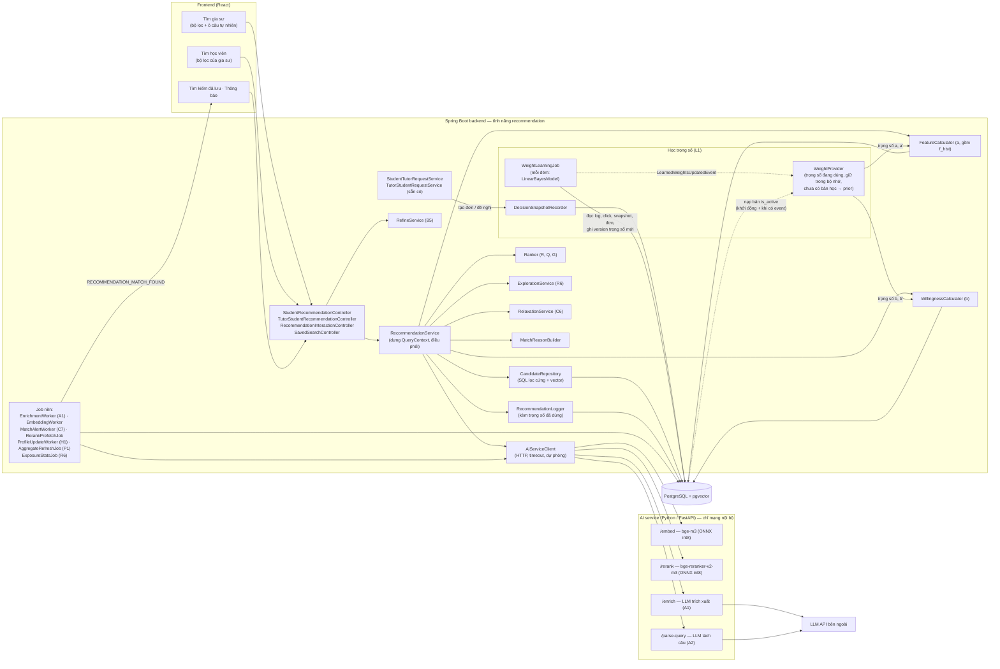
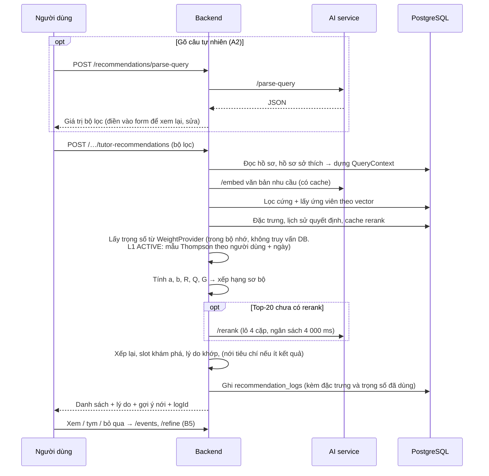
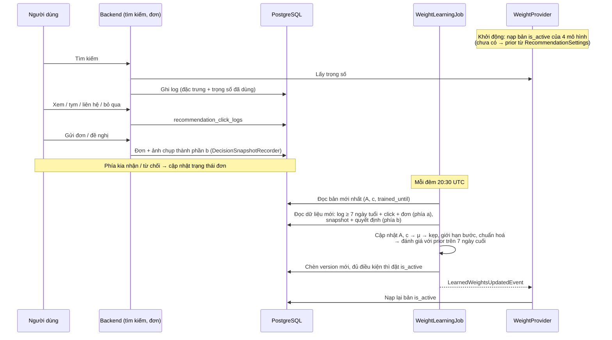

# 2. Kiến trúc tổng thể

> 💡 **File này nói về gì:** Hệ thống gồm những bộ phận nào, chúng nói chuyện với nhau ra sao, việc gì chạy ngay khi người dùng bấm tìm và việc gì chạy nền, mỗi bước được phép mất bao lâu, và code nằm ở thư mục nào. Đọc khi cần hình dung tổng thể trước khi đọc code. Bản ví von dễ hiểu: [00](./00-doc-truoc.md) mục 2.

## 2.1. Thành phần

> 💡 Sơ đồ ba khối: giao diện (React), backend Java (nơi **ra mọi quyết định**: lọc, chấm điểm, xếp hạng) và AI service viết bằng Python (chỉ làm "máy tính": biến chữ thành **vector** — dãy số đại diện ý nghĩa — và chấm độ khớp của một cặp văn bản). Mỗi ô là một lớp (class) trong code, ví dụ `FeatureCalculator` tính điểm phù hợp a, `WillingnessCalculator` tính khả năng đồng ý b. Khối "Học trọng số (L1)" là phần **đang thiết kế**. Nguyên tắc quan trọng: AI service lỗi thì kết quả kém chính xác hơn chứ không báo lỗi cho người dùng.



Nguyên tắc:
- **Backend Java ra quyết định**: lọc, chấm điểm, xếp hạng. AI service chỉ là "máy tính" không
  trạng thái (văn bản → vector / điểm / JSON).
- **AI service không mở ra Internet**; chỉ backend gọi, kèm header bí mật dùng chung.
- **Mọi lời gọi AI service có timeout và dự phòng**; AI service chết thì chất lượng giảm, không lỗi.
- **Trọng số là dữ liệu, không phải code** (L1, 12): `RecommendationSettings` giữ prior và giới hạn; bản học
  được nằm trong `recommendation_learned_weights`; `WeightProvider` là nơi duy nhất các calculator hỏi trọng
  số. Lỗi hoặc tắt L1 → quay về prior, không ảnh hưởng tìm kiếm.

## 2.2. Hai loại luồng

> 💡 Việc được chia hai loại: việc **chạy nền** (không ai phải chờ, ví dụ tính vector cho tin mới đăng) và việc chạy **khi người dùng bấm tìm** (phải nhanh).

### Luồng nền

> 💡 Các "ca trực" chạy định kỳ. Cơ chế chính là **outbox**: khi người dùng lưu hồ sơ hay tin đăng, code ghi thêm một dòng "việc cần làm" vào bảng `ai_enrichment_jobs` **trong cùng lần lưu**, rồi worker (tiến trình chạy nền) lấy việc ra làm: gọi LLM chuẩn hóa văn bản (ENRICH), tính vector (EMBED)… Lỗi thì thử lại sau 1, 5, 15, 60 phút. `FOR UPDATE SKIP LOCKED` là cách để hai bản backend chạy song song không cùng nhận một việc.

| Sự kiện | Việc làm |
|---|---|
| Lưu hồ sơ, tạo/sửa tin học / tin dạy | Ghi job `ENRICH` **và** job `EMBED` vào `ai_enrichment_jobs` trong cùng transaction (outbox) — vector không phải chờ LLM |
| `RecommendationTagService` | Quản trị bộ từ vựng tag: tự nhập hoặc nhờ `/suggest-tags` gợi ý rồi duyệt; thêm / bật / tắt TOPIC thì xếp lại `ENRICH` cho tin của môn đó (04 mục 4.11) |
| `EnrichmentWorker` (mỗi 30 s) | Gọi `/enrich` → kiểm tra, ghi tag, lịch suy ra → tạo lại job `EMBED` (văn bản embedding chứa tên tag) |
| `EmbeddingWorker` | Ghép văn bản, gọi `/embed`, ghi vector của tin đăng / hồ sơ |
| Tin đăng chuyển `OPEN` hoặc có embedding mới | `MatchAlertWorker`: đối chiếu với tin đăng và tìm kiếm đã lưu phía bên kia, gửi thông báo (C7) |
| Click / tym / đơn / đổi trạng thái đơn | `ProfileUpdateWorker`: cập nhật hồ sơ sở thích (H1) |
| Khiếu nại được kết luận (`COMPLAINT_RESOLVED`, `COMPLAINT_AGAINST_YOU_RESOLVED`) | `TutorRecommendationScoreEventListener` tính lại `recommendation_score` nếu người nhận là gia sư (phạt khiếu nại có lỗi — 06, mục 6.8) |
| Hằng đêm | `RerankPrefetchJob` (rerank sẵn top-30 cho tin học `OPEN` và tìm kiếm đã lưu); 02:30 UTC: `AggregateRefreshJob` → tính lại `recommendation_score` → `ExposureStatsJob`; tính lại hồ sơ sở thích (giảm theo thời gian); 20:30 UTC: `WeightLearningJob` cập nhật trọng số học được (L1, 12) |
| Tạo đơn / đề nghị | `DecisionSnapshotRecorder` ghi ảnh chụp các thành phần b của cặp (L1, 12.6) |

Chi tiết hàng đợi (`ai_enrichment_jobs`):
- **Ghi job** bằng `INSERT … ON CONFLICT … DO UPDATE` trên index duy nhất của job đang mở: sửa nhiều lần chỉ
  có một job; nếu job đang `PROCESSING` thì bị đưa về `PENDING` để chạy lại (không mất thay đổi vừa lưu).
- **Hồ sơ đổi** → ghi thêm job cho các tin đăng còn hiệu lực của người đó (văn bản tin đăng chứa hồ sơ).
- **Worker** (mỗi 10 s): chỉ lấy job khi AI service `ready` (service tắt thì job nằm chờ, không tốn lượt thử);
  `FOR UPDATE SKIP LOCKED`; gọi `/embed` từng văn bản, timeout 5 s; lỗi → thử lại sau 1, 5, 15, 60 phút, quá
  5 lần → `FAILED`; văn bản không đổi (`content_hash`) hoặc rỗng → `SKIPPED`; job kẹt `PROCESSING` quá 10 phút
  được trả lại hàng đợi.
- **Quét bù** (2 phút sau khi khởi động, rồi mỗi 6 giờ): ghi job cho hồ sơ / tin đăng chưa có embedding.
- **Ghi job khi nào:** tạo / sửa tin đăng, sửa hồ sơ, **thanh toán xong** (tin thành `OPEN` hoặc chờ duyệt),
  chủ tin **mở lại** tin (`CLOSED` → `OPEN`), admin **duyệt** tin dạy.
- **Chỉ tin đã đăng mới được xử lý:** worker bỏ qua (`SKIPPED`) tin đăng không ở `OPEN` / `MATCHED` — không tốn
  LLM hay embedding cho bản nháp chưa thanh toán và tin chờ duyệt; quét bù cũng chỉ lấy tin đã đăng.
- **Dọn dẹp** (mỗi 6 giờ): xoá job `DONE` / `SKIPPED` cũ hơn 7 ngày (`app.recommendation.jobs.retention-days`);
  giữ `FAILED` để tra lỗi; ghi log số job theo trạng thái, mức `WARN` khi có `FAILED`.
- **Nhiều bản backend:** an toàn nhờ `FOR UPDATE SKIP LOCKED` (có test hai worker cùng nhận job).
- `EnrichmentWorker` chỉ nhận job khi AI service báo `llm = ready` (có khoá API); không có khoá thì job `ENRICH`
  nằm chờ, mọi thứ khác vẫn chạy. Job `ENRICH` thành công gần nhất của mỗi đối tượng **không bị dọn**: mã băm
  của nó giúp không gọi lại LLM khi văn bản không đổi.

### Luồng tìm kiếm

> 💡 Trình tự một lần bấm tìm: (tùy chọn) tách câu gõ thành bộ lọc → gộp tiêu chí → tính vector cho nhu cầu → lọc trong database → chấm điểm → chấm kỹ top-20 (**rerank**) → hoàn thiện danh sách → ghi nhật ký (log) → trả kết quả kèm `logId` (mã của lần tìm, dùng để lật trang và ghi phản hồi). Đi từng bước bằng lời thường: [00](./00-doc-truoc.md) mục 3.



### Vòng học trọng số (L1)

> 💡 Phần **đang thiết kế**: mỗi lần tìm ghi lại trọng số đã dùng; mỗi đêm một job đọc phản hồi (xem, tym, gửi đơn, nhận / từ chối) rồi tính bộ trọng số mới. `WeightProvider` là chỗ duy nhất các bộ tính điểm hỏi "trọng số hiện tại là bao nhiêu"; chưa có bản học được thì trả về trọng số nhóm tự đặt (**prior**). A, c là hai bảng số tích lũy mà mô hình học cập nhật dần (giải thích ở 12 mục 12.3).



Chi tiết: [12](./12-hoc-trong-so.md), mục 12.7–12.9.

## 2.3. Ngân sách độ trễ (mục tiêu p95)

> 💡 Mỗi bước được phép mất tối đa bao lâu. "p95" nghĩa là 95% số lần tìm phải nhanh hơn mốc này. Bước chậm nhất là rerank (chấm kỹ top-20): lần đầu với tiêu chí mới có thể mất tới ~4 giây, những lần sau dùng kết quả đã lưu (cache) nên tổng chỉ khoảng 1,5 giây.

| Bước | Thời gian |
|---|---|
| `/parse-query` (chỉ khi gõ câu; là bước riêng, trước khi bấm tìm) | ≤ 3 000 ms (timeout; đo thực tế 1,8–2,4 s, xem 05 mục 5.4) |
| Embed văn bản nhu cầu (cache theo mã băm) | ≤ 150 ms |
| SQL lọc cứng + vector | ≤ 150 ms |
| Chấm điểm ≤ 200 ứng viên | ≤ 50 ms |
| Rerank top-20 khi chưa có cache | ≤ 4 000 ms (ngân sách; đo thực tế ~175 ms mỗi cặp, xem 06 mục 6.9) |
| Nới tiêu chí (song song) | ≤ 400 ms |
| **Tổng cho một lần bấm tìm** | **≤ 1,5 s khi đã có cache rerank; tới ~5 s ở lần tìm đầu với tiêu chí mới** |

## 2.4. Vị trí code

> 💡 Code của tính năng đặt theo **cấu trúc tầng** sẵn có của repo (controller → service → repository → entity), không tạo thư mục riêng. Danh sách này là tên dự kiến lúc thiết kế; vài lớp khi lập trình mang tên khác (ví dụ slot khám phá nằm ở `ExplorationService`, lý do khớp ở `MatchReasonBuilder`, xếp lại trong phiên ở `RefineService`).

Code đề xuất đặt **theo cấu trúc tầng sẵn có của repo** (quyết định 12/10/2026), không tạo gói
`recommendation/` riêng. Tên lớp giữ như dưới; tiền tố/hậu tố giúp tìm nhanh.

```
backend/src/main/java/com/ptutor/backend/
  controller/  StudentRecommendationController, TutorStudentRecommendationController,
               RecommendationInteractionController, SavedSearchController
  service/     RecommendationService, QueryContextBuilder, FeatureCalculator, WillingnessCalculator,
               Ranker, ExplorationService, RelaxationService, RefineService,
               MatchReasonBuilder, RecommendationLogger, SavedSearchService, PreferenceProfileService,
               WeightProvider, LinearBayesModel, DecisionSnapshotRecorder (L1)
  scheduler/   EnrichmentWorker, EmbeddingWorker, MatchAlertWorker, RerankPrefetchJob,
               ProfileUpdateWorker, AggregateRefreshJob, ExposureStatsJob, WeightLearningJob (L1)
  client/      AiServiceClient (gói mới nếu repo chưa có chỗ phù hợp)
  repository/  CandidateRepository (native SQL), LearningDataRepository (L1), …
  entity/      các bảng mới (03, mục 3.4 và 3.6)
  dto/         request/response của endpoint (08); model tính toán nội bộ (QueryContext, Candidate,
               FeatureVector, ScoredCandidate, …) đặt trong dto/ hoặc gói con riêng của tính năng
  event/       sự kiện kích hoạt tính lại điểm (01, mục 1.5); LearnedWeightsUpdatedEvent (L1)
```

```
ai-service/    (thư mục mới ngang hàng backend/, frontend/)
  app/main.py  app/embed.py  app/rerank.py  app/llm.py  app/schemas.py
  models/      (volume, không commit)
```
