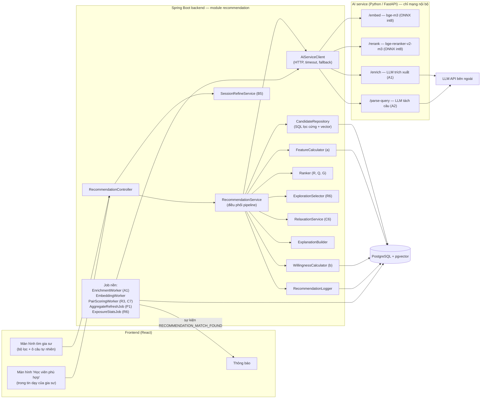
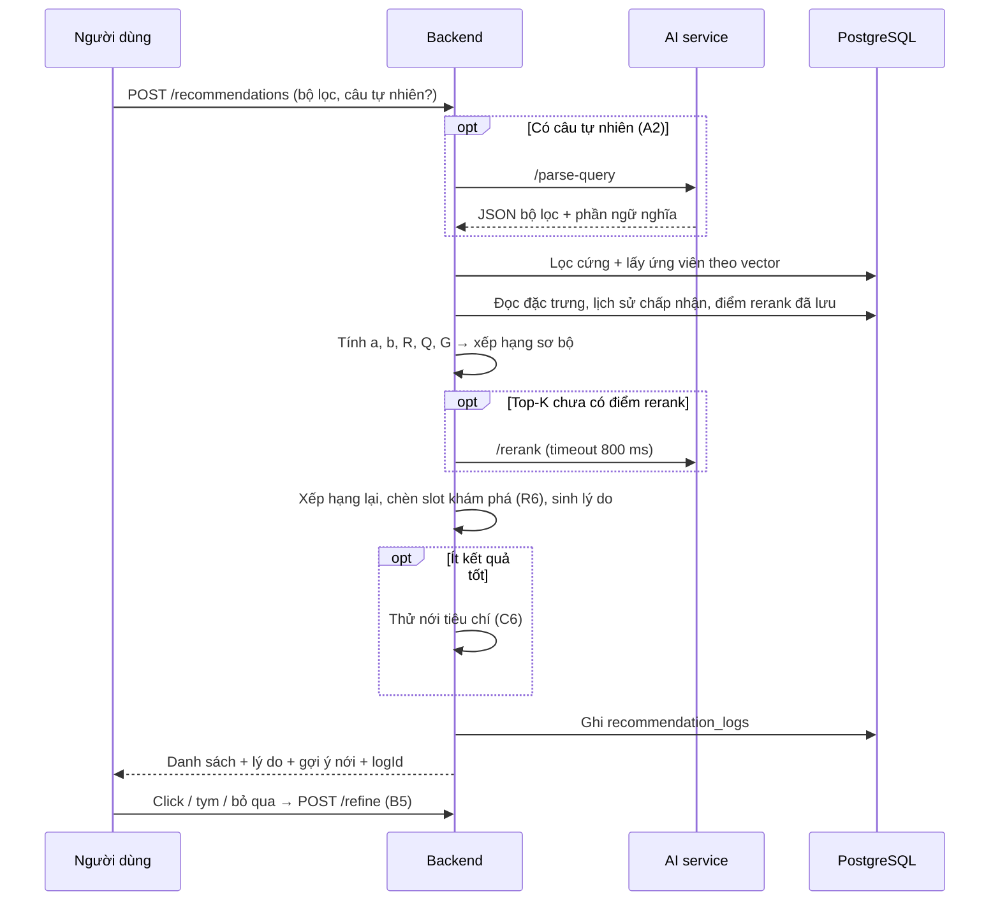

# 2. Kiến trúc tổng thể

## 2.1. Thành phần



Nguyên tắc:
- **Backend Java là nơi quyết định.** Toàn bộ lọc, chấm điểm, xếp hạng nằm trong Spring Boot.
  AI service chỉ là "máy tính" không trạng thái: nhận văn bản, trả vector, điểm hoặc JSON.
- **AI service không mở ra Internet.** Chỉ backend gọi được, kèm header bí mật dùng chung.
- **Mọi lời gọi AI service đều có timeout và phương án dự phòng.** Đề xuất vẫn chạy khi AI
  service chết (chất lượng giảm, không lỗi).

## 2.2. Hai loại luồng

### Luồng nền (không ảnh hưởng độ trễ tìm kiếm)

| Sự kiện | Việc làm |
|---|---|
| Lưu hồ sơ học sinh / gia sư, tạo/sửa tin học / tin dạy | Ghi một job vào `ai_enrichment_jobs` trong cùng transaction (outbox) |
| `EnrichmentWorker` (mỗi 30 giây) | Gọi `/enrich` → ghi tag, lịch rảnh suy ra; rồi tạo job embedding |
| `EmbeddingWorker` | Ghép "văn bản nhu cầu" / "văn bản cung cấp", gọi `/embed`, ghi vector |
| Tin dạy hoặc tin học chuyển `OPEN`, hoặc vừa có embedding mới | `PairScoringWorker` chấm cặp tin mới với các tin `OPEN` phía bên kia, gọi `/rerank` cho các cặp tốt, lưu `recommendation_pair_scores`, gửi thông báo nếu vượt ngưỡng (C7) |
| Hằng ngày 02:30 UTC | `AggregateRefreshJob` (P1) → tính lại `recommendation_score` → `ExposureStatsJob` |

### Luồng tìm kiếm (đồng bộ)



## 2.3. Ngân sách độ trễ (mục tiêu p95)

| Bước | S→T không có câu tự nhiên | Có câu tự nhiên |
|---|---|---|
| `/parse-query` (LLM) | — | ≤ 2 000 ms |
| Embed câu truy vấn | — | ≤ 150 ms |
| SQL lọc cứng + vector | ≤ 150 ms | ≤ 150 ms |
| Chấm điểm ≤ 200 ứng viên | ≤ 50 ms | ≤ 50 ms |
| Rerank top-20 khi chưa có cache | ≤ 800 ms (timeout) | ≤ 800 ms |
| Nới tiêu chí (song song) | ≤ 400 ms | ≤ 400 ms |
| **Tổng** | **≤ 1,5 s** | **≤ 3,5 s** |

Giao diện hiển thị trạng thái "Đang hiểu yêu cầu…" khi có bước LLM.

## 2.4. Vị trí code đề xuất

```
backend/src/main/java/com/ptutor/backend/recommendation/
  controller/RecommendationController.java
  service/RecommendationService.java          # điều phối
  service/FeatureCalculator.java              # a
  service/WillingnessCalculator.java          # b
  service/Ranker.java                         # R, Q, G
  service/ExplorationSelector.java            # R6
  service/RelaxationService.java              # C6
  service/SessionRefineService.java           # B5
  service/ExplanationBuilder.java
  service/RecommendationLogger.java
  job/EnrichmentWorker.java  job/EmbeddingWorker.java
  job/PairScoringWorker.java job/AggregateRefreshJob.java job/ExposureStatsJob.java
  client/AiServiceClient.java
  repository/CandidateRepository.java         # native SQL
  model/  (QueryContext, Candidate, FeatureVector, ScoredCandidate…)
ai-service/   (thư mục mới ngang hàng backend/, frontend/)
  app/main.py  app/embed.py  app/rerank.py  app/llm.py  app/schemas.py
  models/      (volume, không commit)
```

Đặt tất cả trong một package `recommendation` giúp tách bạch với phần nghiệp vụ hiện có và dễ
trình bày trong báo cáo.
