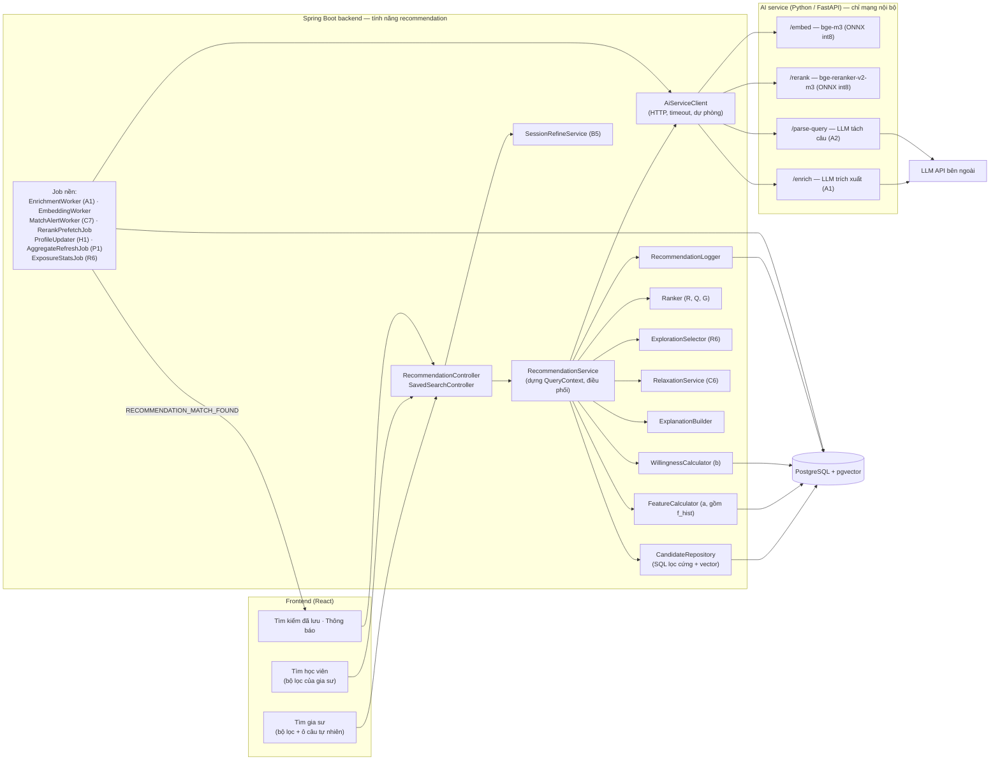
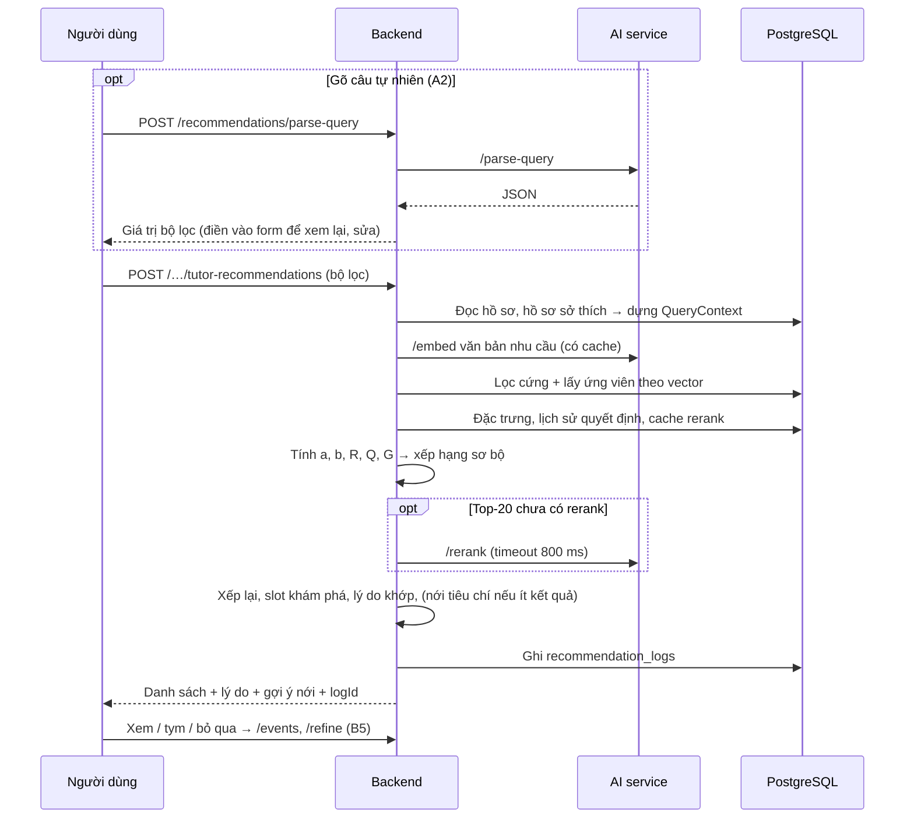

# 2. Kiến trúc tổng thể

## 2.1. Thành phần



Nguyên tắc:
- **Backend Java ra quyết định**: lọc, chấm điểm, xếp hạng. AI service chỉ là "máy tính" không
  trạng thái (văn bản → vector / điểm / JSON).
- **AI service không mở ra Internet**; chỉ backend gọi, kèm header bí mật dùng chung.
- **Mọi lời gọi AI service có timeout và dự phòng**; AI service chết thì chất lượng giảm, không lỗi.

## 2.2. Hai loại luồng

### Luồng nền

| Sự kiện | Việc làm |
|---|---|
| Lưu hồ sơ, tạo/sửa tin học / tin dạy | Ghi job `ENRICH` vào `ai_enrichment_jobs` trong cùng transaction (outbox) |
| `EnrichmentWorker` (mỗi 30 s) | Gọi `/enrich` → ghi tag, lịch suy ra → tạo job `EMBED` |
| `EmbeddingWorker` | Ghép văn bản, gọi `/embed`, ghi vector của tin đăng / hồ sơ |
| Tin đăng chuyển `OPEN` hoặc có embedding mới | `MatchAlertWorker`: đối chiếu với tin đăng và tìm kiếm đã lưu phía bên kia, gửi thông báo (C7) |
| Click / tym / đơn / đổi trạng thái đơn | `ProfileUpdater`: cập nhật hồ sơ sở thích (H1) |
| Hằng đêm | `RerankPrefetchJob` (rerank sẵn top-30 cho tin học `OPEN` và tìm kiếm đã lưu); 02:30 UTC: `AggregateRefreshJob` → tính lại `recommendation_score` → `ExposureStatsJob`; tính lại hồ sơ sở thích (giảm theo thời gian) |

Chi tiết hàng đợi (`ai_enrichment_jobs`):
- **Ghi job** bằng `INSERT … ON CONFLICT … DO UPDATE` trên index duy nhất của job đang mở: sửa nhiều lần chỉ
  có một job; nếu job đang `PROCESSING` thì bị đưa về `PENDING` để chạy lại (không mất thay đổi vừa lưu).
- **Hồ sơ đổi** → ghi thêm job cho các tin đăng còn hiệu lực của người đó (văn bản tin đăng chứa hồ sơ).
- **Worker** (mỗi 10 s): chỉ lấy job khi AI service `ready` (service tắt thì job nằm chờ, không tốn lượt thử);
  `FOR UPDATE SKIP LOCKED`; gọi `/embed` từng văn bản, timeout 5 s; lỗi → thử lại sau 1, 5, 15, 60 phút, quá
  5 lần → `FAILED`; văn bản không đổi (`content_hash`) hoặc rỗng → `SKIPPED`; job kẹt `PROCESSING` quá 10 phút
  được trả lại hàng đợi.
- **Quét bù** (2 phút sau khi khởi động, rồi mỗi 6 giờ): ghi job cho hồ sơ / tin đăng chưa có embedding.
- **Ghi job khi nào:** tạo / sửa tin đăng, sửa hồ sơ, chủ tin **mở lại** tin (`CLOSED` → `OPEN`), admin **duyệt**
  tin dạy (có thể đổi môn tự nhập thành môn trong danh mục).
- **Dọn dẹp** (mỗi 6 giờ): xoá job `DONE` / `SKIPPED` cũ hơn 7 ngày (`app.recommendation.jobs.retention-days`);
  giữ `FAILED` để tra lỗi; ghi log số job theo trạng thái, mức `WARN` khi có `FAILED`.
- **Nhiều bản backend:** an toàn nhờ `FOR UPDATE SKIP LOCKED` (có test hai worker cùng nhận job).
- Trước khi có `EnrichmentWorker` (A1), bước lưu ghi thẳng job `EMBED`; khi có A1 sẽ đổi thành `ENRICH` → `EMBED`.

### Luồng tìm kiếm



## 2.3. Ngân sách độ trễ (mục tiêu p95)

| Bước | Thời gian |
|---|---|
| `/parse-query` (chỉ khi gõ câu; là bước riêng, trước khi bấm tìm) | ≤ 2 000 ms |
| Embed văn bản nhu cầu (cache theo mã băm) | ≤ 150 ms |
| SQL lọc cứng + vector | ≤ 150 ms |
| Chấm điểm ≤ 200 ứng viên | ≤ 50 ms |
| Rerank top-20 khi chưa có cache | ≤ 800 ms (timeout) |
| Nới tiêu chí (song song) | ≤ 400 ms |
| **Tổng cho một lần bấm tìm** | **≤ 1,5 s** |

## 2.4. Vị trí code

Code đề xuất đặt **theo cấu trúc tầng sẵn có của repo** (quyết định 12/10/2026), không tạo gói
`recommendation/` riêng. Tên lớp giữ như dưới; tiền tố/hậu tố giúp tìm nhanh.

```
backend/src/main/java/com/ptutor/backend/
  controller/  RecommendationController, SavedSearchController
  service/     RecommendationService, QueryContextBuilder, FeatureCalculator, WillingnessCalculator,
               Ranker, ExplorationSelector, RelaxationService, SessionRefineService,
               ExplanationBuilder, RecommendationLogger, SavedSearchService, PreferenceProfileService
  scheduler/   EnrichmentWorker, EmbeddingWorker, MatchAlertWorker, RerankPrefetchJob,
               ProfileUpdater, AggregateRefreshJob, ExposureStatsJob
  client/      AiServiceClient (gói mới nếu repo chưa có chỗ phù hợp)
  repository/  CandidateRepository (native SQL), …
  entity/      các bảng mới (03, mục 3.4)
  dto/         request/response của endpoint (08); model tính toán nội bộ (QueryContext, Candidate,
               FeatureVector, ScoredCandidate, …) đặt trong dto/ hoặc gói con riêng của tính năng
  event/       sự kiện kích hoạt tính lại điểm (01, mục 1.5)
```

```
ai-service/    (thư mục mới ngang hàng backend/, frontend/)
  app/main.py  app/embed.py  app/rerank.py  app/llm.py  app/schemas.py
  models/      (volume, không commit)
```
