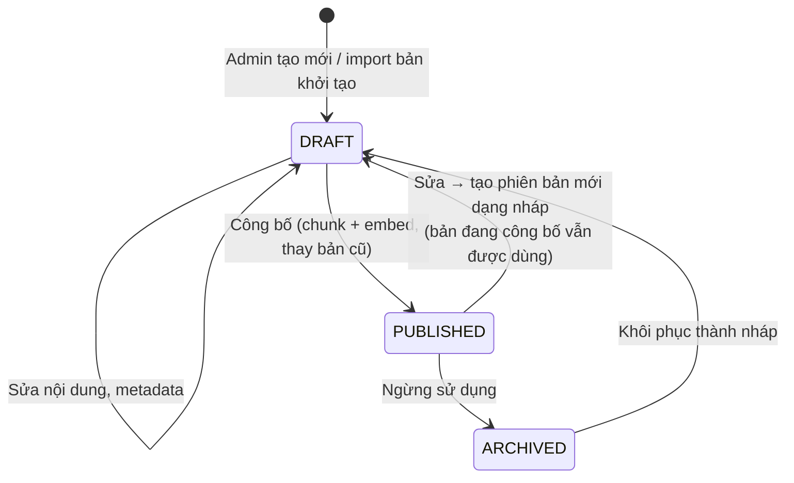

# 3. Kho tri thức — soạn, duyệt, công bố

> 💡 **File này nói về gì:** "kho tri thức" là tập bài viết (quy định, hướng dẫn, hỏi đáp) mà trợ lý được phép dựa vào để trả lời. File mô tả bài viết trông thế nào, ai viết, cách đưa vào hệ thống và cách cắt nhỏ để tìm kiếm.

## 3.1. Nguyên tắc

> 💡 **Nói đơn giản:** Kho do **admin** quản lý trên trang quản trị. Chỉ bài đã "công bố" mới được dùng; bài nháp không bao giờ lọt vào câu trả lời.

- **Bản đang dùng nằm trong DB**, admin quản lý qua trang quản trị (QĐ4). Thư mục `knowledge-base/` trong repo
  chỉ chứa **bản khởi tạo** (sinh từ code), được import vào DB dưới dạng nháp.
- **Một tài liệu = một chủ đề**, ví dụ "Hủy hợp đồng", không gom "mọi thứ về hợp đồng" vào một bài.
- **Không chia vụn:** thân bài mỗi tài liệu khoảng 200–1.200 chữ. Ý nào quá ngắn thì thành một mục `##` trong
  tài liệu gần nhất **cùng đối tượng** (ví dụ "đổi mật khẩu" nằm trong bài "quên mật khẩu"), không tách bài riêng.
  Chatbot tìm theo từng mục chứ không theo cả bài, nên gộp ý ngắn không làm giảm độ chính xác, mà giảm việc duyệt
  và tránh lặp nội dung giữa các bài.
- **Bản xuất PDF** (nếu cần cho người duyệt đọc) gộp theo nhóm chủ đề: một file cho mỗi `features`, mỗi tài liệu là
  một chương. Hệ thống chỉ nạp bản Markdown, không nạp PDF.
- **Viết bằng ngôn ngữ tự nhiên cho người dùng cuối**: câu ngắn, xưng "bạn", dùng đúng tên nút và tên trang trên
  giao diện. Thân bài **không** chứa tên kỹ thuật (tên enum như `PENDING_REVIEW`, tên class, đường dẫn API, tên
  bảng, mã lỗi). Trạng thái ghi bằng nhãn tiếng Việt hiển thị trên giao diện; lỗi ghi bằng câu thông báo người dùng
  thật sự nhìn thấy. Tên kỹ thuật chỉ nằm trong front matter (`source`, `error_codes`) để người duyệt đối chiếu.
- **Giá trị quy định (phí, hạn mức, thời hạn) phải khớp code / cấu hình**; mỗi tài liệu ghi `source` để người
  duyệt đối chiếu.
- **Chỉ bản `PUBLISHED` được truy xuất.** Bản nháp không bao giờ xuất hiện trong câu trả lời cho người dùng.

## 3.2. Vòng đời tài liệu

> 💡 **Nói đơn giản:** Một bài viết đi qua các trạng thái: nháp → công bố → (sửa thành nháp mới) → công bố bản mới… Bản cũ không bị xóa, nên công bố nhầm thì khôi phục được.



- Mỗi lần công bố tạo **phiên bản mới** (`version + 1`); phiên bản cũ chuyển `is_active = false` nhưng **giữ lại**
  để các trích dẫn trong hội thoại cũ vẫn tra được.
- Công bố là thao tác **nguyên tử**: chia đoạn + embedding thành công rồi mới đổi bản active (một transaction);
  `ai-service` lỗi → công bố thất bại, bản cũ vẫn chạy.
- **Trước khi công bố**: kiểm tra hợp lệ (3.3) và **xem trước cách chia đoạn** (số đoạn, số token mỗi đoạn).
- **Khôi phục phiên bản trước**: công bố nhầm hoặc nội dung sai → admin chọn một phiên bản cũ và công bố lại nó
  thành phiên bản mới (không sửa lịch sử).
- **Kiểm tra sau khi cập nhật nội dung**: nhóm chạy bộ câu hỏi mẫu bằng tay sau mỗi đợt cập nhật nội dung lớn
  ([13](./13-thiet-ke-eval.md) mục 13.10). Thử hỏi trên bản nháp và kiểm tra hồi quy tự động khi công bố để ở hướng
  phát triển ([11](./11-lo-trinh-va-van-hanh.md) mục 11.5).

## 3.3. Định dạng tài liệu

> 💡 **Nói đơn giản:** Mỗi bài là văn bản Markdown kèm phần "thông tin về bài" ở đầu (front matter): dành cho ai, thuộc chức năng nào, trang liên quan, căn cứ trong code. Phần thông tin này giúp hệ thống lọc đúng bài cho đúng người.

Nội dung là Markdown; metadata lưu thành cột trong DB và hiện trên form của trang quản trị. Bản khởi tạo trong
repo dùng front matter YAML với cùng các trường:

```markdown
---
id: hop-dong-huy                       # doc_key: duy nhất, kebab-case
title: Hủy hợp đồng
type: policy                           # policy | guide | faq | glossary | error
audience: [STUDENT, TUTOR]             # PUBLIC | STUDENT | TUTOR
features: [contract]                   # mã chức năng, xem 3.7
routes: [/student/contracts]           # trang liên quan, phải có trong danh sách route
source:                                # căn cứ để đối chiếu khi duyệt
  - backend: ContractController PATCH /users/me/contracts/{id}/cancel
  - enum: CancelContractRequestStatus
error_codes: [CONTRACT_CREATOR_REQUIRED]   # mã lỗi liên quan; chỉ để đối chiếu, không viết vào thân bài
keywords: [hủy hợp đồng, chấm dứt, huy hop dong]
todo:                                  # câu hỏi cần admin trả lời (chỉ có ở bản khởi tạo)
  - "Hủy sau khi đã thanh toán kỳ đầu thì học phí còn lại xử lý thế nào?"
---

# Hủy hợp đồng

## Khi nào được hủy
...

## Các bước hủy (học viên)
1. Vào **Hợp đồng** → chọn hợp đồng.
2. ...
```

Kiểm tra khi lưu / công bố (lỗi → không cho công bố, hiện lỗi trên form):

| Kiểm tra | Lỗi khi |
|---|---|
| Đủ trường bắt buộc | Thiếu `doc_key`, `title`, `type`, `audience` |
| `doc_key` duy nhất | Trùng tài liệu khác |
| `audience`, `type`, `features` thuộc danh sách cho phép | Giá trị lạ |
| `routes` thuộc danh sách route cho phép | Route không tồn tại |
| Có ít nhất một heading `##` | Không chia đoạn được |
| Không còn mục `todo` | Còn câu hỏi chưa trả lời |
| Mỗi đoạn sau khi chia ≤ 400 token | Mục quá dài, cần tách heading |

## 3.4. Loại tài liệu

> 💡 **Nói đơn giản:** Năm loại bài: quy định, hướng dẫn thao tác, hỏi đáp thường gặp, "giải nghĩa trạng thái", và "lỗi thường gặp" (để trợ lý giải thích được các mã như `AWAITING_EVIDENCE`).

| `type` | Nội dung | Ví dụ |
|---|---|---|
| `policy` | Quy định, điều kiện, phí, hạn mức | Phí đăng tin, nạp ví, xử lý khiếu nại |
| `guide` | Các bước thao tác | Đăng tin tìm gia sư, nộp chứng chỉ, ký hợp đồng |
| `faq` | Câu hỏi thường gặp, mỗi `##` là một câu hỏi | "Vì sao tin của tôi đang chờ duyệt?" |
| `glossary` | Ý nghĩa trạng thái, thuật ngữ | Trạng thái hợp đồng, trạng thái khiếu nại |
| `error` | Thông báo lỗi người dùng hay gặp: câu thông báo, vì sao bị, cách khắc phục | Không đóng được học phí, không xác nhận được buổi học |

Tài liệu `glossary` giúp trợ lý **diễn giải kết quả tra cứu**: tool trả `status = AWAITING_EVIDENCE` thì trợ lý
truy xuất được "đang chờ bạn bổ sung bằng chứng".

## 3.5. Chia đoạn (chunking)

> 💡 **Nói đơn giản:** Tìm kiếm hoạt động tốt trên **mảnh nhỏ**, nên mỗi bài được cắt theo từng mục (heading). Mỗi mảnh ≤ 400 token (khoảng 250–300 chữ) và luôn kèm tên bài + tên mục. Khi đã tìm thấy mảnh đúng, LLM được đọc **cả mục** chứa nó để không thiếu ý.

- Chia theo heading `##` / `###`; một đoạn = nội dung dưới một heading.
- **Giới hạn 400 token mỗi đoạn**: `ai-service /embed` cắt văn bản ở 512 token, chừa chỗ cho phần ngữ cảnh tiêu
  đề. Đoạn dài hơn → chia theo đoạn văn, chồng lấn ~40 token. Đoạn ngắn hơn ~40 token → gộp với đoạn kế.
- **Mỗi đoạn mang ngữ cảnh**: văn bản đem embed = `title > heading cha > heading` + nội dung.
- Đoạn kế thừa `audience`, `features`, `routes`, `type` của tài liệu; có `anchor` (slug heading) để trích dẫn.
- Embedding theo lô 32 văn bản (giới hạn `AI_EMBED_MAX_BATCH` của `ai-service`).

**Đoạn để tìm và đoạn để đọc (small-to-big).** Đoạn ≤ 400 token chỉ dùng để **tìm** (vector chính xác hơn, vừa giới
hạn 512 token của `/embed`). Khi một đoạn được chọn, model được **đọc cả mục** chứa nó: ghép mọi đoạn cùng phiên bản
tài liệu và cùng `heading_path`, theo `ordinal`, tối đa ~1.200 token (mục dài hơn → lấy đoạn được chọn và các đoạn
liền kề cho tới giới hạn). Như vậy một mục dài bị chia nhỏ vẫn không mất điều kiện / ngoại lệ nằm ở phần sau. Không
tăng trực tiếp giới hạn 400 token vì đoạn càng dài vector càng "loãng" và embed trên CPU càng chậm. Chi tiết dựng
ngữ cảnh: [04](./04-luong-hoi-dap.md) mục 4.3.

## 3.6. Bản khởi tạo sinh từ code

> 💡 **Nói đơn giản:** Để admin không phải viết từ đầu: khi dự án xong, bản đầu tiên của các bài được sinh tự động bằng cách đọc code (màn hình, trạng thái, điều kiện). Chỗ nào code không trả lời được thì để thành câu hỏi (`todo`) cho admin.

Khi dự án đã hoàn thiện, bản khởi tạo được **sinh từ code của nhánh `dev`** (có sự hỗ trợ của AI) rồi import vào DB dạng nháp;
admin duyệt, trả lời các mục `todo`, và công bố.

| Nội dung | Lấy từ |
|---|---|
| Các bước thao tác, tên nút, tên trang | Router và các trang React (`App.tsx`, `pages/...`) |
| Ý nghĩa trạng thái, chuyển trạng thái | Enum, các hàm chuyển trạng thái trong service |
| Điều kiện được / không được làm gì | Validation, các nhánh ném exception trong service |
| Con số quy định | Hằng số (`PaymentService.MIN_WALLET_TOP_UP`…), cấu hình (`VNPAY_EXPIRY_MINUTES`…) |
| Ai được làm gì | `SecurityConfig`, `SecurityConstants` |
| Việc hệ thống tự làm | Scheduler, cron trong cấu hình |
| Lỗi thường gặp và cách khắc phục | Mã lỗi, message của exception |

**Code không trả lời được** (ghi thành `todo`, không đoán): tiêu chí do con người quyết (duyệt khiếu nại, mức hoàn
tiền), lý do của quy định, thông tin ngoài hệ thống (kênh liên hệ, giờ hỗ trợ), và chỗ code có vẻ không khớp
giao diện.

Quy trình: lập danh mục (3.7) → đọc từng luồng controller → service → enum → trang → viết theo template với
`source` cụ thể → báo cáo (tài liệu đã viết, các `todo`, chỗ nghi lệch) → sinh 3–5 câu hỏi mẫu cho mỗi tài liệu
→ `python -m app.kb.import --path ../knowledge-base` tạo bản nháp (không ghi đè tài liệu đã có trong DB, trừ khi
`--overwrite-drafts`).

Để sinh chính xác hơn, khi viết code nên giữ message lỗi rõ nghĩa và đặt con số quy định thành hằng số / cấu hình
có tên.

## 3.7. Danh mục tài liệu

> 💡 **Nói đơn giản:** Danh sách các chủ đề cần viết, căn cứ trong code của từng chủ đề, và chủ đề nào đã sẵn sàng để viết.

Mã chức năng (`features`) và mức sẵn sàng trên `dev` hiện tại.

| `features` | Chủ đề | Căn cứ trong code | Sẵn sàng |
|---|---|---|---|
| `account` | Đăng ký (học viên / gia sư), đăng nhập, quên mật khẩu (OTP), đổi mật khẩu | `AuthController`, `PasswordResetController`, `RegistrationRole` | Có |
| `account` | Tài khoản bị tạm khóa / khóa | `UserStatus`, `SuspensionType`, `AccountSuspensionService` | Một phần |
| `studying-request` | Đăng tin tìm gia sư, sửa, hủy, trạng thái tin, phí đăng tin | `StudyingRequestController`, `RequestStatus`, `STUDYING_REQUEST_FEE` | Có |
| `teaching-request` | Gia sư đăng tin dạy, duyệt tin, phí đăng tin | `TeachingRequestController`, `AdminTeachingRequestController`, `TEACHING_REQUEST_FEE` | Có (giao diện gia sư một phần) |
| `matching` | Ứng tuyển / đề nghị hai chiều, chấp nhận, từ chối | `StudentTutorOfferController`, `StudentTutorRequest*Controller`, `TutorStudentRequestController`, `ApplicationStatus` | Có |
| `contract` | Tạo, ký, từ chối, hủy, gia hạn hợp đồng; trạng thái hợp đồng | `ContractController`, `ContractStatus`, `CancelContractRequestStatus` | Có |
| `payment` | Thanh toán VNPay, bằng ví, kỳ thanh toán học phí; buổi học và xác nhận buổi học trong việc thanh toán theo buổi | `PaymentController`, `PaymentInstallmentStatus`, `StudentLessonController`, `LessonStatus`, `VNPAY_EXPIRY_MINUTES` | Có |
| `wallet` | Nạp ví (10.000 – 100.000.000 đ theo `PaymentService`), lịch sử giao dịch | `WalletController`, `PaymentService` | Có |
| `withdrawal` | Tài khoản ngân hàng, rút tiền, hủy yêu cầu rút, trạng thái | `BankAccountController`, `WithdrawalController`, `WithdrawalRequestStatus` | Có (chưa có trang gia sư) |
| `tutor-profile` | Hồ sơ gia sư, duyệt hồ sơ, lý do bị từ chối | `TutorProfileController`, `AdminTutorProfileReviewController`, `TutorProfileStatus` | Có |
| `certificate` | Nộp chứng chỉ (tệp tối đa 10 MB theo `CertificateFileStorageService`), duyệt, hết hạn | `CertificateController`, `CertificateStatus` | Có |
| `lesson` | Buổi học: gia sư tạo buổi, đánh dấu đã dạy, học viên xác nhận, tự hoàn tất sau 3 ngày, buổi bị giữ | `LessonController`, `StudentLessonController`, `LessonStatus`, `LessonAutoCompletionScheduler` | Có |
| `refund` | Yêu cầu hoàn tiền buổi không diễn ra, gia sư phản hồi trong 48 giờ, mức hoàn 100% / 80% | `StudentRefundRequestController`, `TutorRefundRequestController`, `RefundPolicy`, `RefundCalculator` | Có |
| `complaint` | Gửi khiếu nại, bổ sung bằng chứng, hủy, quy trình xử lý và trạng thái | `ComplaintController`, `AdminComplaintController`, `ComplaintStatus` | Có (chưa có trang người dùng) |
| `review` | Đánh giá gia sư | `PublicReviewController`, `ReviewService` | Một phần |
| `notification` | Thông báo, đánh dấu đã đọc | `NotificationController` | Có |

Bộ tài liệu seed để chạy thử end-to-end trước khi sinh đầy đủ (~8 tài liệu): đăng ký và đăng nhập, quên mật
khẩu, đăng tin tìm gia sư, trạng thái tin đăng (glossary), nạp ví, thanh toán VNPay, trạng thái hợp đồng
(glossary), nộp chứng chỉ.

## 3.8. Danh sách route và câu hỏi gợi ý

> 💡 **Nói đơn giản:** "Route" = đường dẫn trang trên web (vd `/student/wallet`). Trợ lý chỉ được đưa nút dẫn tới các trang có trong danh sách này — không đưa link lạ.

- **Route cho phép** lấy từ router frontend (`frontend/src/App.tsx`), lưu ở `knowledge-base/_routes.yaml`, import
  vào bảng cấu hình; ví dụ `/student/contracts`, `/student/contracts/:contractId`, `/student/wallet`,
  `/tutor/certificates`, `/tutor/proposals`. Route có tham số chỉ được điền bằng ID lấy từ kết quả tool.
- **Câu hỏi gợi ý** theo vai trò và trang ([07](./07-api.md) mục 7.5), admin sửa được trên trang quản trị.
