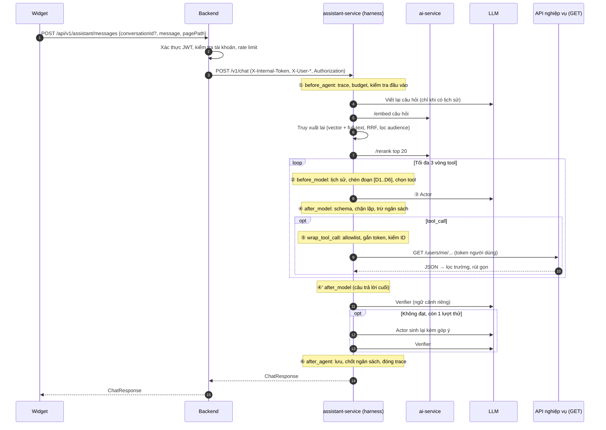
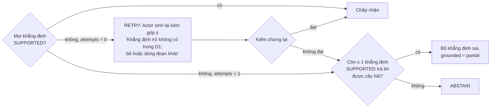

# 4. Luồng hỏi đáp (RAG) và kiểm chứng trích dẫn

## 4.1. Một lượt hội thoại



## 4.2. Kiểm tra đầu vào (①)

- Độ dài tối đa 1.000 ký tự; rỗng → `INVALID_MESSAGE`.
- Che số điện thoại, email, dãy số dài giống số tài khoản / CCCD **trước khi** gửi ra LLM (cùng cách `ai-service`
  làm cho `/enrich`).
- `conversationId` phải thuộc đúng `userId` (header backend gửi), nếu không → `404`.

## 4.3. Viết lại câu hỏi và truy xuất (①)

**Viết lại câu hỏi** — chỉ khi hội thoại có lịch sử: một lời gọi LLM ngắn (không suy luận, timeout ~3 giây) với
đầu vào là các lượt gần nhất **và trạng thái phiên** (mục 4.10: đối tượng đang bàn kèm nhãn), đưa câu hỏi về dạng
độc lập, ví dụ "còn cái tiếng Anh thì sao?" → "Hợp đồng môn Tiếng Anh lớp 7 của tôi đang ở trạng thái nào?". Lỗi /
quá giờ → dùng nguyên câu gốc.

**Truy xuất lai**

| Bước | Chi tiết |
|---|---|
| Lọc | Đoạn của phiên bản `PUBLISHED` đang hiệu lực; `audience` giao với `{PUBLIC, <vai trò>}` |
| Vector | `ai-service /embed` (bge-m3, 1024 chiều) → cosine trên `kb_chunk.embedding`, top 20 |
| Full-text | `tsvector` trên nội dung đã bỏ dấu (`unaccent`) + `keywords`, top 20 |
| Gộp | Reciprocal Rank Fusion: `score = Σ 1 / (60 + rank)` → top 20 |
| Rerank | `ai-service /rerank` (bge-reranker-v2-m3) trên top 20 (giới hạn 40 văn bản / lần); `ai-service` báo rerank `disabled` / lỗi → giữ thứ tự RRF |
| Ưu tiên ngữ cảnh | Đoạn có `routes` khớp `pagePath` cộng thêm điểm nhỏ |
| Cắt | Top 6 đoạn, tổng ≤ ~3.000 token |
| Ngưỡng | Điểm rerank của đoạn tốt nhất < 0,3 (hoặc, khi không rerank: cosine < 0,45 **và** full-text không khớp) → đánh dấu `NO_CONTEXT` |

Ngưỡng là giá trị khởi đầu, hiệu chỉnh trên bộ câu hỏi mẫu ([10](./10-danh-gia.md)).

## 4.4. Sinh câu trả lời — Actor (②–⑤)

Ngữ cảnh gửi model do `ContextInjectionMiddleware` dựng:

- **System prompt** theo vai trò (có `prompt_version`): vai trò trợ lý PTutor; chỉ trả lời dựa trên `<doc>` và
  `<tool_result>`; mỗi câu dựa trên tài liệu gắn mã `[Dn]`; không có căn cứ thì nói chưa có thông tin; không hứa
  hẹn thay nhân viên; không thực hiện thao tác; tiếng Việt (trừ khi người dùng hỏi bằng ngôn ngữ khác). Các quy
  tắc này đều có biện pháp tương ứng ở code ([02](./02-kien-truc.md) mục 2.4).
- **Ngữ cảnh người dùng**: vai trò, trang đang mở, ngày hiện tại. Không gửi họ tên, email.
- **Trạng thái phiên** và **lịch sử** (6 lượt gần nhất, chỉ câu hỏi + câu trả lời cuối, đã bỏ kết quả tool thô),
  theo ngân sách token từng lớp ở mục 4.10.
- **Các đoạn tài liệu** `[D1]…[D6]`: tiêu đề, mục, nội dung.
- **Tool** do `ToolSelectionMiddleware` chọn (tối đa 6), hoặc không có tool.
- Trường hợp `NO_CONTEXT` và không có tool phù hợp → **không gọi Actor**, trả ngay câu trả lời abstain (tiết
  kiệm chi phí, không cho model cơ hội bịa).

## 4.5. Định dạng đầu ra (structured output)

```json
{
  "intent": "POLICY | HOWTO | LOOKUP | CHITCHAT | OUT_OF_SCOPE",
  "claims": [
    {"text": "Mỗi lần nạp ví tối thiểu 10.000 đ.", "source": "D1"},
    {"text": "Hợp đồng Tiếng Anh 7 đang chờ ký.", "source": "tool:list_my_contracts"}
  ],
  "answer": "Markdown ngắn ghép từ các khẳng định, có [1] tại câu dựa trên tài liệu",
  "actions": [{"label": "Mở trang Ví", "route": "/student/wallet"}],
  "suggestions": ["Thanh toán VNPay bị lỗi thì sao?"]
}
```

Yêu cầu model **tách sẵn các khẳng định** (`claims`) kèm nguồn giúp bước kiểm chứng không phải tự tách câu, và
cho phép code kiểm tra từng khẳng định.

## 4.6. Kiểm chứng trích dẫn (④')

Ba loại lỗi trích dẫn và lớp bắt từng loại:

| Loại lỗi | Ví dụ | Bắt bằng |
|---|---|---|
| Khẳng định không có nguồn | Câu nói về phí mà `source` rỗng | Code: mọi `claim` của intent `POLICY` / `HOWTO` phải có `source` |
| Nguồn bịa | `source: "D9"` trong khi chỉ có D1–D6 | Code: `source` phải thuộc tập mã đã đưa vào ngữ cảnh / tên tool đã gọi |
| Gán sai nguồn | `D1` có thật nhưng không nói gì về mức nạp tối thiểu | **Verifier** (LLM) + kiểm tra trích đoạn bằng code |

**Khẳng định từ tài liệu** — một lời gọi verifier cho cả câu trả lời:

- **Đầu vào chỉ gồm**: danh sách khẳng định + **nguyên văn** các đoạn được trích. Verifier **không thấy** câu hỏi
  gốc, lịch sử, lập luận hay câu trả lời hoàn chỉnh của Actor (tránh bị thuyết phục theo Actor).
- **Rubric tường minh**: khẳng định được coi là `SUPPORTED` khi đoạn nguồn nêu trực tiếp nội dung đó (số liệu,
  điều kiện, bước làm trùng khớp); `PARTIAL` khi chỉ đúng một phần; `UNSUPPORTED` khi đoạn không nêu.
- **Đầu ra máy đọc được**:
  ```json
  {"verdicts": [{"claim": 0, "verdict": "SUPPORTED", "evidence": "tối thiểu 10.000 đ", "reason": "..."}]}
  ```
- **Kiểm tra bằng code**: `evidence` phải là chuỗi con (sau chuẩn hóa khoảng trắng) của đoạn nguồn; không phải
  → coi là `UNSUPPORTED`. Bước này chặn trường hợp verifier tự bịa bằng chứng.
- Dùng prompt riêng, nhiệt độ 0; có thể dùng model khác Actor (cấu hình `ASSISTANT_VERIFIER_MODEL`).

**Khẳng định từ tool** — kiểm tra bằng code, không cần LLM: số tiền, ngày, mã trạng thái xuất hiện trong khẳng
định phải có trong kết quả tool đã lọc của lượt này.

**Xử lý kết quả** (critic layer, giới hạn cứng):



- Góp ý chỉ nêu **khẳng định nào sai và vì sao**, ngắn gọn; không đưa lại toàn bộ lượt trước.
- Tối đa **1 lần thử lại** mỗi lượt (`max_verify_retries = 1`) — van an toàn cứng chống lặp và đốt chi phí.
- Chỉ chạy verifier cho intent `POLICY`, `HOWTO`; `LOOKUP` dùng kiểm tra bằng code; `CHITCHAT`, `OUT_OF_SCOPE`
  không cần.

Câu trả lời abstain:

> Mình chưa có thông tin chính thức về vấn đề này. Bạn có thể gửi khiếu nại / liên hệ bộ phận hỗ trợ để
> được nhân viên giải đáp.

## 4.7. Các kiểm tra khác ở ④'

| Kiểm tra | Xử lý khi vi phạm |
|---|---|
| `actions[].route` không thuộc `_routes.yaml` hoặc tham số không thuộc `seen_ids` | Bỏ action |
| `answer` > ~1.200 ký tự | Cắt theo đoạn |
| `OUT_OF_SCOPE` | Câu từ chối lịch sự + gợi ý những gì trợ lý làm được |
| Che thông tin cá nhân | Trước khi lưu log |

## 4.8. Ví dụ

**Hỏi quy định — học viên**: "Nạp ví tối thiểu bao nhiêu?" → truy xuất "Nạp ví > Hạn mức"; Actor: claim
"tối thiểu 10.000 đ, tối đa 100.000.000 đ" nguồn D1; verifier `SUPPORTED`, evidence là chuỗi con của D1 → trả
lời + action "Mở Ví" (`/student/wallet`).

**Tra cứu — học viên**: "Kỳ học phí tiếp theo của hợp đồng Toán là khi nào?" → Actor gọi `list_my_contracts`
→ lấy `id` hợp đồng Toán → gọi `list_my_payment_installments(contractId)` (ID đã có trong `seen_ids`) → claim
ngày và số tiền nguồn `tool:…`; code kiểm tra ngày / số tiền có trong kết quả → trả lời + action tới
`/student/contracts/{id}`.

**Gán sai nguồn bị chặn**: Actor viết "Hủy hợp đồng được hoàn 100% học phí [D2]" nhưng D2 chỉ nói về các bước
hủy → verifier `UNSUPPORTED` → thử lại với góp ý → Actor bỏ câu đó, chỉ giữ các bước hủy (`SUPPORTED`) →
`grounded = partial`, kèm gợi ý liên hệ hỗ trợ về hoàn tiền.

## 4.9. Tham số khởi đầu

| Tham số | Giá trị | Ghi chú |
|---|---|---|
| `history_turns` | 6 | Cửa sổ trượt (mục 4.10) |
| `retrieval_k_each` / `rerank_k` / `context_k` | 20 / 20 / 6 | |
| `rrf_k` | 60 | Hằng số RRF |
| `min_rerank_score` / `min_cosine` | 0,3 / 0,45 | Hiệu chỉnh trên bộ câu hỏi mẫu |
| `max_tools_exposed` | 6 | Chọn tool động |
| `max_tool_calls` / `max_model_calls` | 3 / 4 | Không tính verifier |
| `max_verify_retries` | 1 | |
| `context_token_cap` | 10.000 | Ngữ cảnh tối đa của một lời gọi Actor (phân bổ theo lớp ở 4.10) |
| `turn_token_budget` | 40.000 | Prompt + completion, mọi lời gọi trong lượt (kể cả viết lại câu hỏi, verifier) |
| `llm_timeout_s` / `verifier_timeout_s` / `turn_timeout_s` | 15 / 8 / 25 | Backend chờ 30 giây |

## 4.10. Bộ nhớ hội thoại

### Mô hình bộ nhớ

Theo mô hình 4 loại bộ nhớ ([12](./12-co-so-ly-thuyet.md) mục 12.8), trợ lý **giữ 2 loại và cố ý bỏ 2 loại**:

| Loại | Trong trợ lý | Quyết định và lý do |
|---|---|---|
| Ngắn hạn (working) | Lịch sử + trạng thái phiên của **một hội thoại** | **Có** — thread-scoped, chi tiết bên dưới |
| Ngữ nghĩa (semantic) | Kho tri thức do admin biên tập | **Có** — [03](./03-kho-tri-thuc.md) |
| Dài hạn về người dùng (declarative) | Dữ liệu của người dùng **đã nằm trong DB nghiệp vụ**, lấy mới qua tool mỗi lần cần | **Không lưu thêm.** Hợp đồng, ví, khiếu nại… đổi trạng thái liên tục — thông tin chỉ đúng tại thời điểm truy xuất không được lưu dài hạn. DB nghiệp vụ chính là bộ nhớ dài hạn có nguồn gốc rõ và luôn mới; lưu bản sao chỉ tạo rủi ro trả lời bằng dữ liệu cũ, rủi ro gán nhầm người dùng và trái nguyên tắc tối thiểu hóa dữ liệu |
| Trải nghiệm (episodic, xuyên phiên) | — | **Không.** Mỗi lần hỏi hỗ trợ thường là một việc độc lập; lợi ích thấp so với chi phí lưu trữ, xóa và rủi ro. Người dùng vẫn mở lại được hội thoại cũ để đọc, nhưng trợ lý không nạp hội thoại khác vào ngữ cảnh |

Agent **không bao giờ tự ghi** vào bộ nhớ bền vững (kho tri thức, hồ sơ người dùng): chỉ admin ghi kho tri thức, có
nguồn gốc (`source_refs`, `edited_by`, `published_at`). Điều này loại bỏ rủi ro "đầu độc bộ nhớ" — một lần chèn chỉ
dẫn thành công không thể được lưu lại và lan sang các phiên sau.

### Trạng thái phiên (`session_state`)

Cửa sổ 6 lượt có điểm yếu: nếu người dùng hỏi đi hỏi lại một chi tiết nhỏ, cả cửa sổ chỉ còn chi tiết đó và mất
mạch chính (đang nói về hợp đồng nào, vấn đề nào chưa giải quyết). Vì vậy mỗi hội thoại có thêm một **trạng thái
phiên có cấu trúc**, lưu ở `conversation.session_state` ([06](./06-du-lieu-va-schema.md)), **do code cập nhật** ở
hook `after_agent` — không tốn lời gọi LLM, không do model tự viết:

```json
{
  "focus": [
    {"type": "contract", "id": "11111111-…-0002", "label": "Tiếng Anh · Lớp 7",
     "source": "tool:list_my_contracts", "turn": 1, "last_turn": 3}
  ]
}
```

| Trường | Cập nhật từ | Dùng để |
|---|---|---|
| `focus` | **Chỉ từ kết quả tool** đã lọc: ID + nhãn ngắn (môn · khối, mã yêu cầu…), lượt xuất hiện, lượt nhắc gần nhất. Tối đa 20 mục, bỏ mục lâu không nhắc nhất | Viết lại câu hỏi ("cái tiếng Anh" → đúng hợp đồng); tập `seen_ids` cho kiểm tra nguồn gốc ID ([05](./05-cong-cu-tra-cuu.md)) và route (mục 4.7) |


**Không làm (hướng phát triển, [11](./11-lo-trinh-va-van-hanh.md) mục 11.5):** tóm tắt bằng LLM phần lịch sử đã ra
khỏi cửa sổ, và các trường `topics` (chủ đề đang hỏi), `unresolved` (câu chưa trả lời được). Lý do: hội thoại hỗ trợ
hiếm khi dài quá 6–12 lượt; `focus` đã giữ được đối tượng đang bàn; việc chọn tài liệu / tool đã có `pagePath` và các
đoạn truy xuất được. Hội thoại vượt 20 lượt → widget gợi ý "Bắt đầu cuộc trò chuyện mới".

Phân biệt nguồn: `focus` chỉ nhận dữ liệu từ tool, **không** từ lời người dùng. Người dùng nói "hợp đồng tôi thanh
toán rồi" mà tool cho kết quả khác → **dữ liệu tool thắng**; trợ lý nói rõ theo hệ thống đang ghi nhận thế nào và gợi
ý liên hệ hỗ trợ nếu thấy sai. Quy tắc / chính sách luôn thắng mong muốn của người dùng.

### Ngân sách token theo lớp ngữ cảnh

`ContextInjectionMiddleware` dựng ngữ cảnh theo thứ tự lớp cố định và ngân sách từng lớp (giá trị khởi đầu, đo lại
bằng `turn_trace`):

| Thứ tự | Lớp | Ngân sách | Khi vượt `context_token_cap` |
|---|---|---|---|
| 1 | Policy + system prompt (theo vai trò, có phiên bản) | Cố định (~1.500) | **Không bao giờ cắt** — hành vi phải nhất quán |
| 2 | Mô tả tool (≤ 6) | ~1.200 | Không cắt nội dung; chỉ giảm số tool được chọn |
| 3 | Ngữ cảnh người dùng (vai trò, trang, ngày) | ~100 | Không cắt |
| 4 | Trạng thái phiên (`focus`) | ≤ 300 | Cắt sau cùng: bỏ `focus` cũ nhất |
| 5 | Đoạn tài liệu | ≤ 3.000 | Bỏ đoạn hạng thấp nhất (giữ tối thiểu 2) |
| 6 | Kết quả tool của lượt hiện tại | ≤ 2.000 | Giảm `max_items`, giữ tổng số |
| 7 | Lịch sử | ≤ 1.500 (~15%) | **Cắt trước tiên**: bỏ lượt cũ nhất (`focus` vẫn giữ đối tượng đang bàn) |

Thứ tự cắt khi vượt: lịch sử → kết quả tool → đoạn tài liệu → trạng thái phiên. Lớp 1–3 không bao giờ bị cắt.
Số token thực tế từng lớp được ghi vào span của lời gọi model để phân tích phân bổ ([13](./13-thiet-ke-eval.md) mục 13.11).

### Phạm vi và xóa

- Mọi thứ trong bộ nhớ ngắn hạn thuộc **một `conversation_id` của một `user_id`**; mỗi lượt đều kiểm tra quyền sở
  hữu trước khi nạp. Không có cơ chế chia sẻ ngữ cảnh giữa người dùng hay giữa các hội thoại.
- Xóa hội thoại xóa cả `session_state` và mọi bản ghi liên quan, có kiểm chứng ([09](./09-bao-mat-va-quyen-rieng-tu.md) mục 9.3).
