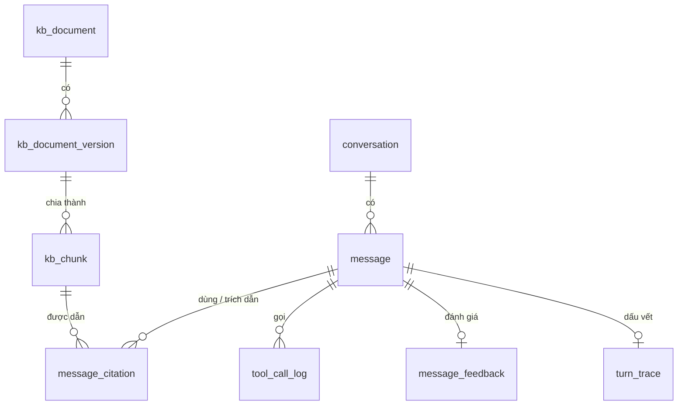

# 6. Dữ liệu và schema

## 6.1. Vị trí và quyền

- Cùng cơ sở dữ liệu PostgreSQL của hệ thống (image `pgvector/pgvector:pg17`, extension `vector` đã bật ở
  `V1__create_initial_schema.sql`), **schema riêng `assistant`**.
- Role `assistant_app`: toàn quyền trên schema `assistant`, **không có quyền** trên schema `public`.
- Migration do `assistant-service` quản lý bằng **Alembic** (`assistant-service/migrations`), độc lập với Flyway.
  Flyway của backend chỉ thêm một migration nhỏ:

```sql
-- backend: V25__create_assistant_schema.sql (số phiên bản chốt khi gộp vào dev)
CREATE EXTENSION IF NOT EXISTS unaccent;
CREATE SCHEMA IF NOT EXISTS assistant;
-- unaccent() không phải IMMUTABLE nên không dùng trực tiếp trong cột sinh tự động / chỉ mục được.
-- Bọc trong hàm IMMUTABLE với từ điển chỉ định rõ:
CREATE OR REPLACE FUNCTION assistant.f_unaccent(text) RETURNS text
  LANGUAGE sql IMMUTABLE PARALLEL SAFE STRICT
  AS $$ SELECT public.unaccent('public.unaccent'::regdictionary, $1) $$;
-- Role và mật khẩu tạo ngoài migration (biến môi trường).
```

- `user_id` là UUID lấy từ claim `sub`, **không đặt khóa ngoại** sang `public.users` (giữ tách biệt). Job dọn
  dẹp xóa dữ liệu theo `user_id` khi cần ([09](./09-bao-mat-va-quyen-rieng-tu.md)).

## 6.2. Sơ đồ



## 6.3. Kho tri thức

### `assistant.kb_document` — tài liệu (định danh ổn định)

| Cột | Kiểu | Ghi chú |
|---|---|---|
| `id` | `uuid` PK | |
| `doc_key` | `varchar(120)` UNIQUE | kebab-case |
| `active_version_id` | `uuid` FK → `kb_document_version`, null | Phiên bản đang công bố; null = chưa công bố / đã lưu trữ |
| `status` | `varchar(20)` | `DRAFT` (chưa từng công bố), `PUBLISHED`, `ARCHIVED` |
| `created_by`, `created_at` | `uuid`, `timestamptz` | |

### `assistant.kb_document_version` — từng phiên bản

| Cột | Kiểu | Ghi chú |
|---|---|---|
| `id` | `uuid` PK | |
| `document_id` | `uuid` FK | |
| `version` | `int` | Tăng dần theo tài liệu; `UNIQUE (document_id, version)` |
| `state` | `varchar(20)` | `DRAFT`, `PUBLISHED`, `SUPERSEDED`, `ARCHIVED` |
| `title` | `varchar(255)` | |
| `type` | `varchar(20)` | `policy`, `guide`, `faq`, `glossary` |
| `audience` | `varchar(20)[]` | `PUBLIC`, `STUDENT`, `TUTOR` |
| `features` | `varchar(40)[]` | |
| `routes` | `varchar(200)[]` | |
| `keywords` | `varchar(80)[]` | |
| `source_refs` | `jsonb` | Căn cứ trong code |
| `todo` | `jsonb` | Câu hỏi còn mở (phải rỗng mới công bố) |
| `content_md` | `text` | Nội dung Markdown |
| `content_hash` | `char(64)` | |
| `origin` | `varchar(20)` | `IMPORT` (bản khởi tạo) / `ADMIN` |
| `edited_by`, `edited_at` | `uuid`, `timestamptz` | |
| `published_by`, `published_at` | `uuid`, `timestamptz` | |
| `restored_from_version` | `int`, null | Khi phiên bản được tạo bằng "khôi phục phiên bản trước" |

Chỉ mục duy nhất một phần: mỗi tài liệu có tối đa một phiên bản `DRAFT` và một phiên bản `PUBLISHED`.

### `assistant.kb_chunk` — đoạn (chỉ sinh khi công bố)

| Cột | Kiểu | Ghi chú |
|---|---|---|
| `id` | `uuid` PK | |
| `version_id` | `uuid` FK → `kb_document_version` | |
| `ordinal` | `int` | |
| `heading_path` | `varchar(500)` | `Hủy hợp đồng > Các bước hủy (học viên)` |
| `anchor` | `varchar(200)` | |
| `content` | `text` | Nội dung hiển thị / đưa cho model |
| `search_text` | `text` | `title > heading_path` + nội dung — văn bản đem embed |
| `tsv` | `tsvector` | `to_tsvector('simple', assistant.f_unaccent(search_text \|\| ' ' \|\| keywords))` — tính khi công bố (hoặc cột sinh tự động dùng `f_unaccent`); câu hỏi cũng đi qua `f_unaccent` trước khi tạo `tsquery` |
| `embedding` | `vector(1024)` | bge-m3 qua `ai-service` |
| `embedding_model` | `varchar(80)` | `bge-m3-int8` (giá trị `model` do `/embed` trả) |
| `token_count` | `int` | ≤ 400 |
| `audience`, `features`, `routes`, `type` | | Sao chép từ phiên bản để lọc không cần join |
| `is_active` | `boolean` | `true` khi phiên bản là bản đang công bố |

Chỉ mục: HNSW `embedding vector_cosine_ops` (một phần, `WHERE is_active`); GIN `tsv`; GIN `audience`;
B-tree `(version_id, heading_path, ordinal)` để mở rộng đoạn thành cả mục (small-to-big).

Đổi model embedding: chạy `python -m app.kb.reembed` → embed lại mọi đoạn `is_active`; `embedding_model` cho biết
đoạn nào còn cũ. Số chiều khác 1024 cần migration đổi cột.

### `assistant.scope_exemplar`

Câu mẫu cho lớp chặn ngoài phạm vi ([04](./04-luong-hoi-dap.md) mục 4.11).

| Cột | Kiểu | Ghi chú |
|---|---|---|
| `id` | `uuid` PK | |
| `text` | `varchar(500)` | |
| `label` | `varchar(10)` | `IN`, `OUT` |
| `source` | `varchar(20)` | `DATASET` (từ tập dev), `ADMIN` |
| `embedding` | `vector(1024)` | |
| `embedding_model` | `varchar(80)` | |
| `created_by`, `created_at` | `uuid`, `timestamptz` | |

Ít dòng (vài trăm) → so khớp bằng quét tuần tự, không cần chỉ mục.

### `assistant.kb_setting`

Cấu hình admin sửa được: danh sách route cho phép, câu hỏi gợi ý theo vai trò / trang, luật chặn ngoài phạm vi
(`scope_rules`). Cột `key`, `value jsonb`,
`updated_by`, `updated_at`.

## 6.4. Hội thoại

### `assistant.conversation`

| Cột | Kiểu | Ghi chú |
|---|---|---|
| `id` | `uuid` PK | |
| `user_id` | `uuid` | Từ JWT |
| `user_role` | `varchar(20)` | |
| `title` | `varchar(200)` | Từ câu hỏi đầu (cắt ngắn) |
| `created_at`, `last_message_at` | `timestamptz` | |
| `session_state` | `jsonb` | Bộ nhớ ngắn hạn có cấu trúc: `focus` — các đối tượng đang bàn ([04](./04-luong-hoi-dap.md) mục 4.10). Chỉ chứa ID + nhãn ngắn, **không** chứa trạng thái, số tiền hay dữ liệu nghiệp vụ khác |
| `ended_at` | `timestamptz`, null | Phiên đã kết thúc (đăng xuất / "Cuộc trò chuyện mới"); gửi tiếp → `409` ([04](./04-luong-hoi-dap.md) mục 4.10) |
| `deleted_at` | `timestamptz` | Đánh dấu đã xóa (tombstone): từ thời điểm này hội thoại không bao giờ được nạp / trả về |

Chỉ mục: `(user_id, last_message_at DESC)`.

### Xóa hội thoại

Dữ liệu của một hội thoại nằm ở 6 bảng: `conversation`, `message`, `message_citation`, `tool_call_log`,
`turn_trace`, `message_feedback`. Toàn bộ việc xóa đi qua **một hàm duy nhất** `purge_conversation(conversation_id)`
chạy trong một transaction (khóa ngoại `ON DELETE CASCADE` từ `message` sang các bảng con), sau đó **kiểm chứng**
bằng truy vấn đếm trên cả 6 bảng = 0 và ghi kết quả vào `assistant.deletion_log`:

| Cột | Kiểu | Ghi chú |
|---|---|---|
| `id` | `uuid` PK | |
| `conversation_id` | `uuid` | Không phải khóa ngoại (bản ghi gốc đã bị xóa) |
| `requested_at`, `purged_at` | `timestamptz` | |
| `rows_deleted` | `jsonb` | Số dòng đã xóa theo từng bảng |
| `verified` | `boolean` | Kiểm chứng sau xóa đạt |

`deletion_log` không chứa `user_id` hay nội dung.

### `assistant.message`

| Cột | Kiểu | Ghi chú |
|---|---|---|
| `id` | `uuid` PK | |
| `conversation_id` | `uuid` FK | |
| `sender` | `varchar(10)` | `USER`, `ASSISTANT` |
| `reply_to_message_id` | `uuid` FK → `message` | Với `ASSISTANT`: câu hỏi mà tin này trả lời |
| `content` | `text` | Câu hỏi đã che thông tin / câu trả lời; xóa sau thời hạn lưu |
| `rewritten_query` | `text` | Chỉ `USER` |
| `intent` | `varchar(20)` | |
| `grounded` | `varchar(10)` | `FULL`, `PARTIAL`, `NONE` (abstain) |
| `fallback_reason` | `varchar(40)` | `NO_CONTEXT`, `VERIFY_FAILED`, `SCHEMA_INVALID`, `TOOL_ERROR`, `BUDGET`, `TIMEOUT` |
| `verification` | `jsonb` | Verdict từng khẳng định, số lần thử lại |
| `actions` | `jsonb` | |
| `page_path` | `varchar(200)` | |
| `llm_model`, `prompt_version` | `varchar` | Để so sánh khi đổi model / prompt |
| `created_at` | `timestamptz` | |

### `assistant.message_citation`

| Cột | Kiểu | Ghi chú |
|---|---|---|
| `message_id` | `uuid` FK | Tin `ASSISTANT` |
| `chunk_id` | `uuid` FK | |
| `rank` | `int` | Thứ hạng sau rerank |
| `vector_score`, `text_score`, `rrf_score`, `rerank_score` | `real` | |
| `in_context` | `boolean` | Có được đưa vào ngữ cảnh model không |
| `cited` | `boolean` | Có được trích dẫn trong câu trả lời cuối không |

PK `(message_id, chunk_id)`.

### `assistant.tool_call_log`

| Cột | Kiểu | Ghi chú |
|---|---|---|
| `id` | `uuid` PK | |
| `message_id` | `uuid` FK | |
| `tool_name` | `varchar(80)` | |
| `args` | `jsonb` | Chỉ ID, enum |
| `blocked_reason` | `varchar(40)` | `NOT_ALLOWED`, `UNSEEN_ID`, `DUPLICATE`, `BUDGET` — null nếu được chạy |
| `http_status` | `int` | |
| `latency_ms` | `int` | |
| `result_items` | `int` | Số mục trả về — **không lưu nội dung** |
| `created_at` | `timestamptz` | |

### `assistant.turn_trace`

Một lượt = một trace; phục vụ debug, đo chi phí và **so sánh hai cấu hình harness** trên cùng bộ câu hỏi.

| Cột | Kiểu | Ghi chú |
|---|---|---|
| `message_id` | `uuid` PK, FK | Tin `ASSISTANT` |
| `request_id` | `varchar(64)` | `X-Request-Id`, trùng với log backend |
| `config_hash` | `char(12)` | Băm cấu hình harness (tham số, phiên bản prompt, model) |
| `status` | `varchar(20)` | `OK`, `ABSTAINED`, `BUDGET_EXCEEDED`, `ERROR` |
| `spans` | `jsonb` | `[{name, kind: model|tool|retrieval|verify, start_ms, duration_ms, tokens_in, tokens_out, status}]` |
| `total_ms` | `int` | |
| `tokens_in`, `tokens_out` | `int` | Tổng mọi lời gọi model (kể cả rewrite, verifier) |
| `model_calls`, `tool_calls`, `verify_retries` | `smallint` | |

### `assistant.message_feedback`

| Cột | Kiểu | Ghi chú |
|---|---|---|
| `message_id` | `uuid` PK, FK | Tin `ASSISTANT` |
| `user_id` | `uuid` | |
| `rating` | `smallint` | `1` 👍, `-1` 👎 |
| `reason` | `varchar(30)` | `WRONG`, `NOT_HELPFUL`, `OUTDATED`, `OTHER` |
| `comment` | `varchar(500)` | |
| `created_at` | `timestamptz` | |

## 6.5. Truy vấn "câu hỏi chưa trả lời được"

Nguồn cho trang quản trị, để admin bổ sung tài liệu:

```sql
SELECT u.content AS question, u.rewritten_query, a.grounded, a.fallback_reason, f.reason, a.created_at
FROM assistant.message a
JOIN assistant.message u ON u.id = a.reply_to_message_id
LEFT JOIN assistant.message_feedback f ON f.message_id = a.id
WHERE a.sender = 'ASSISTANT'
  AND (a.grounded <> 'FULL' OR f.rating = -1)
  AND a.created_at > now() - interval '30 days'
ORDER BY a.created_at DESC;
```

## 6.6. Dữ liệu ở backend

Bảng `support_requests` (yêu cầu hỗ trợ) thuộc **schema `public` của backend**, do Flyway quản lý, vì đây là dữ liệu
nghiệp vụ giữa người dùng và nhân viên: [14](./14-yeu-cau-ho-tro.md) mục 14.4.
