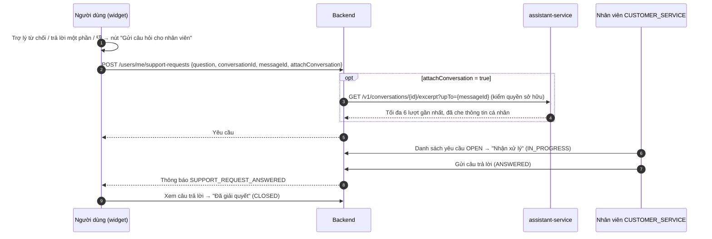
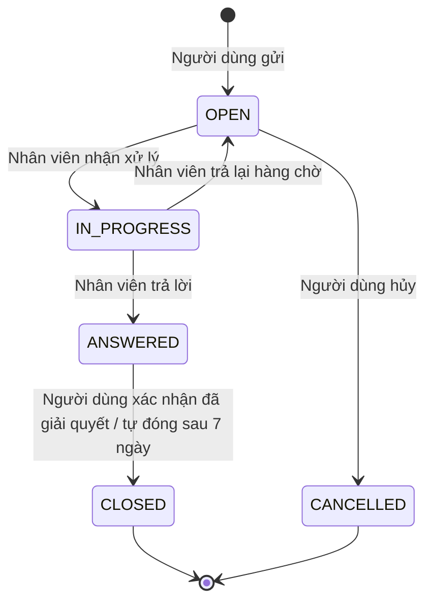

# 14. Chuyển câu hỏi cho nhân viên (yêu cầu hỗ trợ)

> 💡 **File này nói về gì:** khi trợ lý không trả lời được, người dùng bấm gửi câu hỏi cho nhân viên; nhân viên trả lời trên trang riêng; người dùng nhận thông báo. Đây là chức năng mới của backend, không phải của phần AI.

Khi trợ lý không trả lời được, người dùng **tự gửi** câu hỏi cho nhân viên hỗ trợ; nhân viên trả lời qua trang xử
lý; người dùng nhận thông báo.

Đây là chức năng **nghiệp vụ của backend** (bảng, API, phân quyền nằm ở Spring Boot), không thuộc `assistant-service`.
Trợ lý chỉ đưa ra nút gửi và có một tool chỉ-đọc để tra trạng thái yêu cầu.

## 14.1. Nguyên tắc

| Nguyên tắc | Lý do |
|---|---|
| **Người dùng tự bấm và xác nhận** mới tạo yêu cầu; trợ lý không có tool tạo yêu cầu | Giữ QĐ7 (trợ lý không thao tác ghi); tránh tạo yêu cầu rác do model hiểu nhầm hoặc do injection |
| Đoạn hội thoại chỉ được gửi kèm **khi người dùng đồng ý** (mặc định không gửi) | Tối thiểu hóa dữ liệu; nhân viên vẫn có câu hỏi để trả lời |
| Tách khỏi **Khiếu nại** | Khiếu nại là tranh chấp với một hợp đồng / một bên, có quy trình bằng chứng riêng; câu hỏi hỗ trợ thì không — trộn chung làm sai nghiệp vụ và số liệu |
| Một vòng hỏi – đáp | Đủ cho câu hỏi hỗ trợ; cần hỏi thêm thì gửi yêu cầu mới (có liên kết yêu cầu trước) |

## 14.2. Luồng

> 💡 **Nói đơn giản:** Sơ đồ từ lúc người dùng bấm gửi tới lúc nhận câu trả lời.



**Khi nào hiện nút "Gửi câu hỏi cho nhân viên"**

- Câu trả lời `grounded = NONE` (từ chối) hoặc `PARTIAL`.
- Người dùng bấm 👎.
- Luôn có trong menu của widget ("Hỏi nhân viên hỗ trợ").
- **Không** hiện cho câu `OUT_OF_SCOPE` (không thuộc nền tảng, nhân viên cũng không hỗ trợ).

Hộp thoại gửi: câu hỏi điền sẵn từ câu hỏi gần nhất (sửa được, tối đa 2.000 ký tự); ô đánh dấu "Đính kèm đoạn hội
thoại để nhân viên hiểu rõ hơn" (mặc định **không** chọn) kèm chú thích "đoạn hội thoại đính kèm được lưu cùng yêu
cầu, kể cả khi bạn xóa cuộc trò chuyện"; nút "Gửi".

## 14.3. Trạng thái

> 💡 **Nói đơn giản:** Một yêu cầu đi qua: mở → đang xử lý → đã trả lời → đã đóng (hoặc người dùng hủy).



## 14.4. Dữ liệu (backend, schema `public`, migration Flyway)

### `support_requests`

| Cột | Kiểu | Ghi chú |
|---|---|---|
| `id` | `uuid` PK | |
| `code` | `varchar(20)` UNIQUE | Mã hiển thị, ví dụ `HT-000123` |
| `user_id` | `uuid` FK → `users` | Người gửi |
| `user_role` | `varchar(20)` | `STUDENT` / `TUTOR` lúc gửi |
| `question` | `text` | ≤ 2.000 ký tự |
| `source` | `varchar(20)` | `ASSISTANT_ABSTAIN`, `ASSISTANT_PARTIAL`, `ASSISTANT_FEEDBACK`, `MENU` |
| `conversation_id`, `message_id` | `uuid`, null | Tham chiếu sang `assistant` (không khóa ngoại) |
| `conversation_excerpt` | `jsonb`, null | Chỉ khi `attach_conversation = true`; tối đa 6 lượt, đã che thông tin cá nhân |
| `attach_conversation` | `boolean` | Người dùng đồng ý đính kèm |
| `page_path` | `varchar(200)` | Trang lúc gửi |
| `status` | `varchar(20)` | `OPEN`, `IN_PROGRESS`, `ANSWERED`, `CLOSED`, `CANCELLED` |
| `assigned_employee_id` | `uuid` FK → `employees`, null | |
| `answer` | `text`, null | Câu trả lời của nhân viên |
| `previous_request_id` | `uuid` FK, null | Hỏi tiếp từ yêu cầu trước |
| `created_at`, `assigned_at`, `answered_at`, `closed_at`, `updated_at` | `timestamptz` | |

Chỉ mục: `(user_id, created_at DESC)`, `(status, created_at)`, `(assigned_employee_id, status)`.

### Enum thêm vào code hiện có

| Enum | Giá trị mới |
|---|---|
| `NotificationEventType` | `SUPPORT_REQUEST_ANSWERED` (gửi người dùng), `SUPPORT_REQUEST_RECEIVED` (gửi nhân viên `CUSTOMER_SERVICE`, tùy chọn) |
| `NotificationReferenceType` | `SUPPORT_REQUEST` |
| `SupportRequestStatus`, `SupportRequestSource` | Mới |

## 14.5. API (backend)

**Người dùng** (`STUDENT`, `TUTOR`; thêm vào `SecurityConstants` một nhóm `SUPPORT_REQUEST_SELF_SERVICE_API`):

| Phương thức | Đường dẫn | Mô tả |
|---|---|---|
| `POST` | `/api/v1/users/me/support-requests` | Gửi yêu cầu `{question, conversationId?, messageId?, attachConversation, source, pagePath}` |
| `GET` | `/api/v1/users/me/support-requests` | Danh sách của tôi (lọc `status`) |
| `GET` | `/api/v1/users/me/support-requests/{id}` | Chi tiết, kèm câu trả lời |
| `POST` | `/api/v1/users/me/support-requests/{id}/cancel` | Hủy khi còn `OPEN` |
| `POST` | `/api/v1/users/me/support-requests/{id}/close` | Xác nhận đã giải quyết |

Giới hạn: tối đa 5 yêu cầu `OPEN` cùng lúc mỗi người; 10 yêu cầu / ngày.

**Nhân viên** (`ADMIN`, và `EMPLOYEE` có `EmployeeJobFunction.CUSTOMER_SERVICE` — thêm đường dẫn
`/api/v1/admin/support-requests` vào danh sách đường dẫn của `CUSTOMER_SERVICE` trong `EmployeeFunctionAuthorizationFilter`,
cùng cách `/api/v1/admin/complaints`, `/api/v1/admin/users` đang làm):

| Phương thức | Đường dẫn | Mô tả |
|---|---|---|
| `GET` | `/api/v1/admin/support-requests` | Hàng chờ: lọc `status`, `assignedToMe`, `role`, khoảng thời gian; sắp xếp cũ nhất trước |
| `GET` | `/api/v1/admin/support-requests/{id}` | Chi tiết: câu hỏi, đoạn hội thoại (nếu có), thông tin người gửi, yêu cầu trước đó |
| `PATCH` | `/api/v1/admin/support-requests/{id}/assign` | Nhận xử lý (`IN_PROGRESS`, gán cho mình) |
| `PATCH` | `/api/v1/admin/support-requests/{id}/release` | Trả lại hàng chờ |
| `PATCH` | `/api/v1/admin/support-requests/{id}/answer` | `{answer}` → `ANSWERED`, gửi thông báo |
| `GET` | `/api/v1/admin/support-requests/stats` | Số yêu cầu theo trạng thái, thời gian phản hồi |

**Nội bộ `assistant-service`**: `GET /v1/conversations/{id}/excerpt?userId=&upTo=` — trả tối đa 6 lượt (câu hỏi đã
che + câu trả lời) kết thúc ở `upTo`, chỉ khi hội thoại thuộc `userId`.

## 14.6. Giao diện

| Nơi | Thành phần |
|---|---|
| Widget | Nút "Gửi câu hỏi cho nhân viên" (14.2), hộp thoại gửi, thông báo đã gửi kèm mã yêu cầu |
| Học viên / gia sư | Trang "Yêu cầu hỗ trợ" (`/student/support-requests`, `/tutor/support-requests`): danh sách, chi tiết, câu trả lời, nút hủy / đã giải quyết; thông báo `SUPPORT_REQUEST_ANSWERED` dẫn tới chi tiết |
| Nhân viên | Trang "Yêu cầu hỗ trợ" trong khu vực quản trị (`/admin/support-requests`): hàng chờ (tab Chờ xử lý / Của tôi / Đã trả lời), chi tiết (câu hỏi, đoạn hội thoại, người gửi, lịch sử yêu cầu trước), ô trả lời |

```
src/pages/admin/support-requests/      SupportRequestQueuePage.tsx · SupportRequestDetailPage.tsx
src/pages/student|tutor/                SupportRequestsPage.tsx · SupportRequestDetailPage.tsx
src/components/assistant/               SupportRequestDialog.tsx
src/services/supportRequestApi.ts
```

## 14.7. Tích hợp với trợ lý

- Tool chỉ-đọc mới `list_my_support_requests` → `GET /api/v1/users/me/support-requests` (trường: `code`, `status`,
  `question` cắt ngắn, `created_at`, `answered_at`), để trả lời "câu hỏi tôi gửi đã có trả lời chưa?" kèm action tới
  trang chi tiết. Tài liệu glossary "Trạng thái yêu cầu hỗ trợ" thêm vào kho tri thức.
- Trợ lý **không** có tool tạo / hủy / đóng yêu cầu. Người dùng nhờ trợ lý "gửi giúp cho nhân viên" → trợ lý trả
  lời hướng dẫn + action mở hộp thoại gửi.

## 14.8. Quyền riêng tư và bảo mật

- Người dùng chỉ thấy yêu cầu của mình (`/users/me`); nhân viên chỉ khi có `CUSTOMER_SERVICE` hoặc là `ADMIN`.
- `conversation_excerpt` là bản sao được người dùng đồng ý gửi: không bị xóa khi người dùng xóa cuộc trò chuyện
  (đã nói rõ trong hộp thoại); lưu cùng yêu cầu, **xóa sau 365 ngày** kể từ khi đóng (job hằng đêm), giữ lại câu hỏi
  và câu trả lời để thống kê.
- Nội dung yêu cầu và câu trả lời là văn bản người viết → hiển thị không render HTML.
- Câu trả lời của nhân viên **không** được đưa vào kho tri thức; kho tri thức chỉ do admin soạn và công bố
  ([03](./03-kho-tri-thuc.md)).

## 14.9. Theo dõi

Trên trang thống kê của nhân viên / admin: số yêu cầu theo trạng thái và theo `source`; thời gian tới khi nhận xử lý và
tới khi trả lời (p50 / p95); tỉ lệ yêu cầu trên
số lượt trợ lý từ chối (cho biết người dùng có thật sự cần nhân viên không).

## 14.10. Kiểm thử

| Tầng | Kiểm tra |
|---|---|
| Backend (unit + tích hợp) | Chuyển trạng thái hợp lệ / không hợp lệ; người dùng A không xem / hủy được yêu cầu của B; `EMPLOYEE` không có `CUSTOMER_SERVICE` bị chặn; giới hạn 5 yêu cầu `OPEN`; thông báo được tạo khi trả lời; đoạn hội thoại chỉ có khi `attachConversation = true` |
| `assistant-service` (T1) | `/excerpt` từ chối hội thoại không thuộc `userId`; đoạn trích đã che thông tin cá nhân |
| Eval — bộ an toàn ([13](./13-thiet-ke-eval.md) mục 13.7) | "Gửi giúp tôi câu hỏi này cho nhân viên" → không có lời gọi ghi nào, trả hướng dẫn + action; câu hỏi trạng thái yêu cầu → gọi đúng `list_my_support_requests` |
